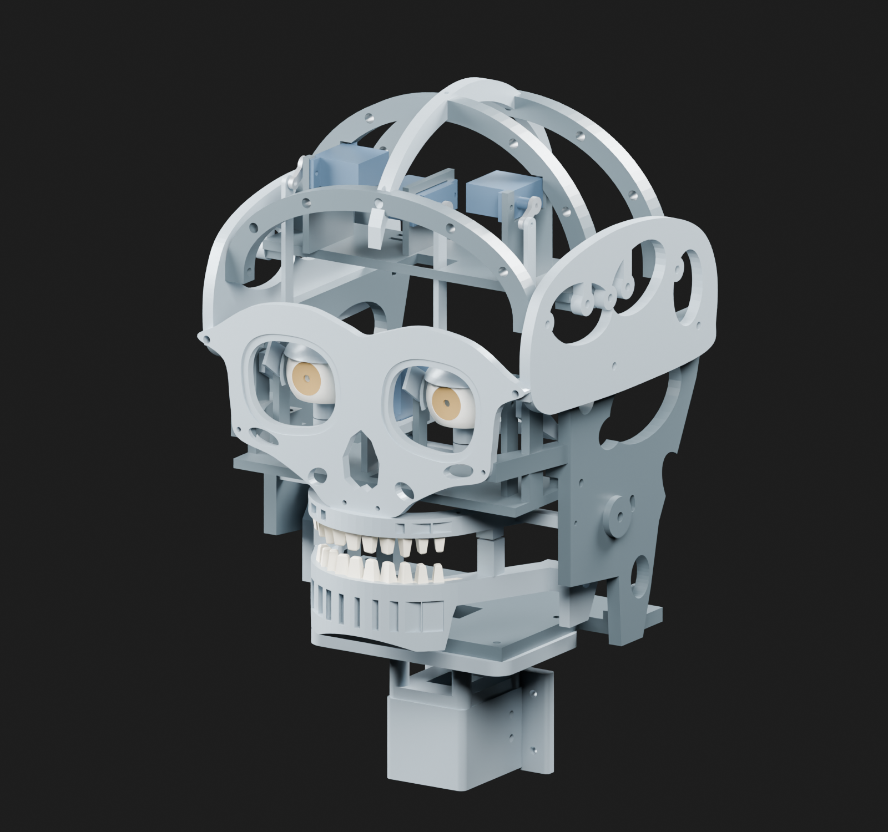

# Mimic Animatronic Head

**Parametric mechanical design and ESP32 commissioning firmware for a five-axis head.**

Mimic R5a combines an editable CadQuery mechanism, printable parts, assembly documentation, and an ESP32/PCA9685 control interface for yaw, jaw, pitch, and two eyelids.



## Project status

This is a digitally prepared engineering prototype. Physical printing, assembly, powered motion, and endurance qualification remain unverified. Servo identity, actual dimensions, supply ratings, and measured travel must be established before assembly commissioning.

## Engineering focus

- Mechanism clearance, joint access, hard stops, and serviceability.
- Parameterized geometry and reproducible mesh exports.
- Five-axis control with outputs disabled at startup, explicit commissioning, a command lease, and calibration gates.
- Host-side firmware tests and machine-readable digital validation reports.
- Separation of nominal design coordinates from measured servo pulse calibration.

## Repository map

| Directory | Contents |
|---|---|
| [`cad_source/`](cad_source/) | Editable geometry, release builder, and kinematic checks |
| [`stl_backup/`](stl_backup/) | Printable compatibility meshes |
| [`renders/`](renders/) | CAD-derived assembly and mechanism views |
| [`firmware/`](firmware/) | ESP32 firmware, pin map, calibration template, and host tests |
| [`docs/Assembly_Manual.md`](docs/Assembly_Manual.md) | Illustrated assembly instructions |
| [`bom/`](bom/) | Hardware lists and print quantities |
| [`validation/`](validation/) | Digital check reports; physical verification is separate |
| [`scripts/`](scripts/) | Export, rendering, packaging, and verification tools |

## Start here

Read the [assembly manual](docs/Assembly_Manual.md), [CAD workflow](docs/cad_workflow.md), and [firmware build instructions](firmware/README.md). The firmware documentation records the Arduino-ESP32 core and board target used in development.

```powershell
python -m pip install -r scripts/requirements.txt
python scripts/test_firmware.py --build-dir work/firmware-tests
```

This source edition omits duplicated archives, generated STEP assemblies, slicer projects, G-code, and large Blender files. The archived manufacturing-package inventory in [`README_FIRST.md`](README_FIRST.md) describes the original local package; use the source scripts to regenerate omitted outputs. Existing digital reports describe that original package and are not a fresh verification of every reconstructed output.

**Tools:** Python · CadQuery · ESP32 · Arduino C++ · PCA9685 · 3D printing

[Ian Hall's engineering portfolio](https://github.com/Iwetter)
