# Mimic R5a-E1
## Assembly and commissioning manual

For the five-axis V5 build that uses an M3 screw kit, follow the [V5 M3 assembly guide](../variants/r5a-m3-retrofit/ASSEMBLY.md).

For the R4 build that uses an M3 screw kit, follow the [R4 M3 assembly guide](../variants/r4-m3-retrofit/START_HERE.md).

**Flashforge Adventurer 5M | 220 x 220 x 220 mm | 0.4 mm nozzle | PLA**

This manual accompanies the revised parametric model, print plates, electrical design and commissioning firmware. The approved external appearance is retained. The package records digital engineering work; no head has been printed, assembled, powered or physically qualified by this workflow.

**Release scope:** supervised prototype manufacture and measured commissioning. Actual servo identity, dimensions, spline, voltage/current limits and power-supply rating remain unresolved. The user's tentative markings `sg950` and `mg950` are not interpreted as SG90 or MG90S. Do not order a final mount-compatible servo or energize the assembled mechanism by relying on those names.

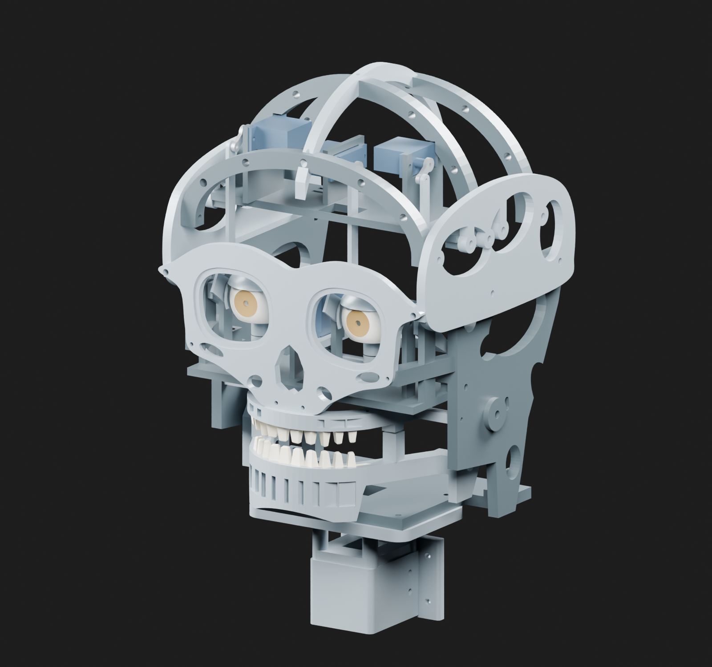

## 1. How to use this package

1. Read `README_FIRST.md` and the final validation reports before printing. Release limitations and open issues override historical concept reports.
2. Inventory the parts and hardware in sections 2-4. Confirm the actual servo dimensions against the mechanical interface contract before printing actuator mounts.
3. Print and measure the fit coupons, then print the approved plates in the sequence in section 5. A valid mesh or bed-fit result alone does not establish print success.
4. Assemble the supported mechanism unpowered using section 6. Keep cosmetic covers removable until travel, retention and cable access are checked.
5. Wire and inspect with all supplies isolated. Commission each detached servo before coupling it to the mechanism. The firmware starts with assembled motion locked.
6. Complete `docs/physical_verification.csv` and `firmware/calibration_record.csv`. Enter only measured results. A simulation, compile or host test does not change a physical result from NOT TESTED to PASS.

### Tools and consumables

- Digital caliper, metric ruler, feeler gauges and an angle gauge; record instrument resolution.
- Appropriate metric hex keys, nut drivers and screwdrivers for the actual purchased fasteners and servo OEM screws.
- Deburring knife, flush cutters, small files and hand reamers/drills for measured fit finishing; eye protection when cutting or drilling.
- Pliers, correct crimp tool and terminals, heat-shrink, cable labels and removable strain relief.
- Multimeter, current-limited regulated bench supply and scope or logic analyzer for pulse and reset verification.
- Stable bench support for the head and jaw; the assembly can move or drop when servo torque is absent.
- PLA filament suitable for the chosen profile. Keep lubricant, paint and adhesive off fits, electrical contacts and service joints unless a step expressly requires them.

### Datum and service conventions

Assembly coordinates are X right, Y rear and Z up; the face looks toward -Y. Left/right part names follow the final CAD labels. Match the labeled views and IDs instead of mirroring parts by intuition. Dimensions in this manual and the drawing set are millimetres unless stated otherwise.

The drawing set is a geometry reference from the final STEP parts, with independent orthographic view scales and overall dimensions. Do not measure lengths from the page. Critical fits and fastener stacks come from the source/contract and the assembly steps. The preserved P01/P03 interfaces are extracted from the supplied assembly; the actual original R4 release was not supplied.

Keep modules removable. Do not glue structural joints as a substitute for missing retention or excessive clearance. Record any approved finishing/rework in the physical log and preserve the release files as the baseline for the next revision.


<!-- pagebreak -->
# 2. Printed components

The IDs below are generated from the final geometry contract. Quantities are assembly quantities; print extras only when the plate map explicitly identifies coupons or spares. STEP components retain assembly coordinates. Use the oriented 3MF files for printing.

| ID | Printed component | Qty |
| --- | --- | --- |
| P01 | torso spine socket | 1 |
| P03 | skeletal neck tenon | 1 |
| P20 | skull base plate | 1 |
| P21 | lower wall L | 1 |
| P22 | lower wall R | 1 |
| P23 | upper cranial plate L | 1 |
| P24 | upper cranial plate R | 1 |
| P25 | cranial arch front | 1 |
| P26 | cranial arch mid | 1 |
| P27 | cranial arch rear | 1 |
| P28 | sagittal crest | 1 |
| P29 | face mask | 1 |
| P30 | zygoma L | 1 |
| P31 | zygoma R | 1 |
| P32 | maxilla arch | 1 |
| P33 | mandible | 1 |
| P34 | eye globe | 2 |
| P35 | iris insert | 2 |
| P36 | eye deck | 1 |
| P37 | yaw crank | 2 |
| P38 | yaw tie half | 2 |
| P39 | upper lid L | 1 |
| P40 | upper lid R | 1 |
| P41 | mechanism deck | 1 |
| P42 | upper teeth row | 1 |
| P43 | lower teeth row | 1 |
| P44 | jaw servo cradle | 1 |
| P45 | common pitch carrier | 1 |
| P46 | eye pitch pushrod | 1 |
| P49 | lid pushrod | 2 |
| P90 | hardware fit coupon | 1 |

<!-- pagebreak -->
# 3. Mechanical hardware

Each quantity below counts one complete fastener/retention set described in that row, not one individual washer. Locations are assembly-coordinate reference points and the direction is the nominal fastener axis. Verify actual engagement, clearance and access during dry assembly. All physical fits remain unverified.

| Hardware ID | Qty | Complete set | Grip (mm) |
| --- | --- | --- | --- |
| H_BASE_P21 | 2 | M3x16 socket screw + 2 flat washers + M3 hex nut | 10 |
| H_BASE_P22 | 2 | M3x16 socket screw + 2 flat washers + M3 hex nut | 10 |
| H_PLATE_P23 | 2 | M3x18 socket screw + 2 washers + M3 hex nut | 11 |
| H_PLATE_P24 | 2 | M3x18 socket screw + 2 washers + M3 hex nut | 11 |
| H_ARCH_P25 | 2 | M3x20 socket screw + 2 washers + M3 nut | 14 |
| H_ARCH_P26 | 2 | M3x20 socket screw + 2 washers + M3 nut | 14 |
| H_ARCH_P27 | 2 | M3x20 socket screw + 2 washers + M3 nut | 14 |
| H_CREST | 3 | M2x16 socket screw + 2 washers + M2 nut | 10 |
| H_FACE_P23 | 1 | M3x20 socket screw + 2 washers + M3 nut | 12.5 |
| H_ZYG_P30 | 1 | M2x10 screw + washers + M2 nut | 6.5 |
| H_FACE_P24 | 1 | M3x20 socket screw + 2 washers + M3 nut | 12.5 |
| H_ZYG_P31 | 1 | M2x10 screw + washers + M2 nut | 6.5 |
| H_MAX_P21 | 1 | M2x16 screw + 2 washers + M2 nut | 12 |
| H_MAX_P22 | 1 | M2x16 screw + 2 washers + M2 nut | 12 |
| H_MAX_FACE | 2 | M2x16 screw + washers + M2 nut | 8.5 |
| H_TEETH_P42 | 2 | M1.6x16 screw + 2 washers + M1.6 nut | 10 |
| H_TEETH_P43 | 2 | M1.6x16 screw + 2 washers + M1.6 nut | 10 |
| H_EYE_DECK_-1 | 1 | M3x18 screw + 2 washers + M3 nut | 12 |
| H_ZYG_ROOT_-1 | 1 | M3x25 screw + 2 washers + M3 nut | 16 |
| H_PITCH_PIVOT_-1 | 1 | M3x16 screw + 3 washers + M3 nyloc nut | 8 |
| H_LID_STOP_-1 | 1 | M2x12 screw + 2 washers + M2 nyloc nut | 5 |
| H_EYE_DECK_1 | 1 | M3x18 screw + 2 washers + M3 nut | 12 |
| H_ZYG_ROOT_1 | 1 | M3x25 screw + 2 washers + M3 nut | 16 |
| H_PITCH_PIVOT_1 | 1 | M3x16 screw + 3 washers + M3 nyloc nut | 8 |
| H_LID_STOP_1 | 1 | M2x12 screw + 2 washers + M2 nyloc nut | 5 |
| H_YAW_SHAFT_-1 | 1 | Ground steel shaft Ø3 x33mm; collars separately H_YAW_COLLARS | 0 |
| H_YAW_SHAFT_1 | 1 | Ground steel shaft Ø3 x33mm; collars separately H_YAW_COLLARS | 0 |
| H_PITCH_STOP | 1 | M2x12 screw + 2 washers + M2 nyloc nut | 7.5 |
| H_SERVO_YAW | 2 | M2x10 screw + washers + M2 nut | 6 |
| H_GLOBE_CLAMP | 2 | M2x8 set screw + M2 plain nut | 5 |
| H_YAW_CRANK_CLAMP | 2 | M2x8 set screw + M2 plain nut | 5 |
| H_YAW_LINK_LEFT | 1 | M2x20 screw + 2 washers + M2 nyloc nut + 1mm spacer | 12 |
| H_YAW_LINK_RIGHT | 1 | M2x16 screw + 2 washers + M2 nyloc nut + 3.5mm spacer | 8 |
| H_YAW_LINK_CENTRE | 1 | M2x16 screw + 3 washers + M2 nyloc nut + 1mm spacer | 8 |
| H_DECK_-1 | 2 | M3x20 screw + 2 washers + M3 nut | 13 |
| H_SERVO_LID_-1 | 2 | M2x10 screw + 2 washers + M2 nut | 5 |
| H_DECK_1 | 2 | M3x20 screw + 2 washers + M3 nut | 13 |
| H_SERVO_LID_1 | 2 | M2x10 screw + 2 washers + M2 nut | 5 |
| H_SERVO_PITCH | 2 | M2x10 screw + 2 washers + M2 nut | 5 |
| H_PITCH_ROD | 2 | M2x16 screw + 2 washers + M2 nyloc nut + metal spacer | 9 |
| H_LID_PIVOTS | 4 | M2x10 screw + 2 washers + M2 nyloc nut | 5 |
| H_LID_RODS | 4 | M2x14 screw + 2 washers + M2 nyloc nut + metal spacer | 8 |
| H_JAW_LEFT_PIVOT | 1 | M3x18 socket screw + one0.5mm washer + M3x4 heat-set insert | 13.4 |
| H_JAW_RIGHT_PIVOT | 1 | M3x25 socket screw + two0.5mm washers + M3 nyloc nut | 18.4 |
| H_JAW_SLEEVE | 2 | Brass/stainless tube Ø4OD/Ø3.2ID, cut12.9±0.05mm, square deburred ends | 0 |
| H_JAW_STOP | 1 | M3x25 screw + 2 washers + M3 nyloc nut | 14.5 |
| H_JAW_HORN | 2 | M2x10 screw + 2 washers + M2 nut | 7 |
| H_JAW_CRADLE_BASE | 2 | M3x16 screw + 2 washers + M3 nut | 10 |
| H_SERVO_JAW | 2 | M2x10 screw + 2 washers + M2 nut | 4.5 |
| H_NECK_FLANGE | 4 | M3x20 screw + 2 washers + M3 nut | 12 |
| H_NECK_LOCK | 2 | M3x45 screw + 2 washers + M3 nut | 38 |
| H_IRIS_RTV | 1 | Neutral-cure flexible RTV adhesive, two1mm dots per iris | 0 |
| H_OEM_HORNS | 5 | OEM horns plus manufacturer-specific spline centre screws | 0 |
| H_YAW_COLLARS | 4 | Split shaft collar Ø3ID/≤7OD/3mm long, screw retained | 0 |

## Installation and location schedule
The notes below come directly from the current hardware contract. Use these notes together with the numbered sequence; do not clamp a running pivot by tightening it like a structural bolt.
### H_BASE_P21
Screw from above; hold nut below base before P03 installation. Location(s) X,Y,Z: (-63, 33, 0); (-63, 41, 0). Axis: (0, 0, 1).
### H_BASE_P22
Screw from above; hold nut below base before P03 installation. Location(s) X,Y,Z: (63, 33, 0); (63, 41, 0). Axis: (0, 0, 1).
### H_PLATE_P23
Heads outside, nuts accessible inside before installing mechanism deck. Location(s) X,Y,Z: (-79, 5, 122); (-79, 68, 124). Axis: (-1, 0, 0).
### H_PLATE_P24
Heads outside, nuts accessible inside before installing mechanism deck. Location(s) X,Y,Z: (79, 5, 122); (79, 68, 124). Axis: (1, 0, 0).
### H_ARCH_P25
Outside heads, inward nuts; fit arch before crest. Location(s) X,Y,Z: (-79, -45, 151.5); (79, -45, 151.5). Axis: (1, 0, 0).
### H_ARCH_P26
Outside heads, inward nuts; fit arch before crest. Location(s) X,Y,Z: (-79, 2, 151.5); (79, 2, 151.5). Axis: (1, 0, 0).
### H_ARCH_P27
Outside heads, inward nuts; fit arch before crest. Location(s) X,Y,Z: (-79, 52, 151.5); (79, 52, 151.5). Axis: (1, 0, 0).
### H_CREST
Trim screw only if measured joint differs; confirm at least 1.5 threads beyond nut. Location(s) X,Y,Z: (0, -45, 210); (0, 2, 210); (0, 52, 210). Axis: (0, 0, 1).
### H_FACE_P23
Nut at rear of pad; mount mask after eye cassette. Location(s) X,Y,Z: (-74.5, -62, 125.5). Axis: (0, 1, 0).
### H_ZYG_P30
Front screw, nut behind zygoma root; inspect actual mating overlap before tightening. Location(s) X,Y,Z: (-59, -62, 90). Axis: (0, 1, 0).
### H_FACE_P24
Nut at rear of pad; mount mask after eye cassette. Location(s) X,Y,Z: (74.5, -62, 125.5). Axis: (0, 1, 0).
### H_ZYG_P31
Front screw, nut behind zygoma root; inspect actual mating overlap before tightening. Location(s) X,Y,Z: (59, -62, 90). Axis: (0, 1, 0).
### H_MAX_P21
Fit before jaw; align and clamp side strut to lower wall. Location(s) X,Y,Z: (-74, -16, 60). Axis: (-1, 0, 0).
### H_MAX_P22
Fit before jaw; align and clamp side strut to lower wall. Location(s) X,Y,Z: (74, -16, 60). Axis: (1, 0, 0).
### H_MAX_FACE
Straight front access; nuts behind new maxilla pad atY-53.5. Location(s) X,Y,Z: (-8, -62, 67); (8, -62, 67). Axis: (0, 1, 0).
### H_TEETH_P42
Rear carrier only; upper grip8mm, lower10mm. Trim excess only after confirming nut engagement and travel. Location(s) X,Y,Z: (-33, -40.5, 56.6); (33, -40.5, 56.6). Axis: (0, 0, 1).
### H_TEETH_P43
Rear carrier only; upper grip8mm, lower10mm. Trim excess only after confirming nut engagement and travel. Location(s) X,Y,Z: (-32, -41, 35.5); (32, -41, 35.5). Axis: (0, 0, 1).
### H_EYE_DECK_-1
Bolt wall to fixed eye deck; inside nut accessible before globes. Location(s) X,Y,Z: (-74, -12, 76). Axis: (-1, 0, 0).
### H_ZYG_ROOT_-1
One root bolt joins P30/P31 to eye deck shoe. Nested shoe is relieved from fixed support; verify nut engagement at underside. Location(s) X,Y,Z: (-65, -15, 90). Axis: (0, 0, 1).
### H_PITCH_PIVOT_-1
Stationary screw, moving carrier running bore. Set nyloc for 0.2–0.4 axial play, not clamped. Location(s) X,Y,Z: (-68, -36.25, 112.5). Axis: (-1, 0, 0).
### H_LID_STOP_-1
Pin traverses fixed curved slot. Nut outside; retain loose enough to slide. Location(s) X,Y,Z: (-52.3, -28.25, 112.5). Axis: (-1, 0, 0).
### H_EYE_DECK_1
Bolt wall to fixed eye deck; inside nut accessible before globes. Location(s) X,Y,Z: (74, -12, 76). Axis: (1, 0, 0).
### H_ZYG_ROOT_1
One root bolt joins P30/P31 to eye deck shoe. Nested shoe is relieved from fixed support; verify nut engagement at underside. Location(s) X,Y,Z: (65, -15, 90). Axis: (0, 0, 1).
### H_PITCH_PIVOT_1
Stationary screw, moving carrier running bore. Set nyloc for 0.2–0.4 axial play, not clamped. Location(s) X,Y,Z: (68, -36.25, 112.5). Axis: (1, 0, 0).
### H_LID_STOP_1
Pin traverses fixed curved slot. Nut outside; retain loose enough to slide. Location(s) X,Y,Z: (52.3, -28.25, 112.5). Axis: (1, 0, 0).
### H_YAW_SHAFT_-1
Deburr cut shaft84..117; 3.2 running bore in carrier, upper collar105.2..108.2; shaft clamped independently to globe and crank. Location(s) X,Y,Z: (-33.75, -36.25, 84). Axis: (0, 0, 1).
### H_YAW_SHAFT_1
Deburr cut shaft84..117; 3.2 running bore in carrier, upper collar105.2..108.2; shaft clamped independently to globe and crank. Location(s) X,Y,Z: (33.75, -36.25, 84). Axis: (0, 0, 1).
### H_PITCH_STOP
Left carrier pin slides in R14 fixed slot. Set washer/nyloc gap; approximately±14deg physical stop. Location(s) X,Y,Z: (-62, -22.25, 112.5). Axis: (1, 0, 0).
### H_SERVO_YAW
Measure actual flange pitch before purchase/print; nominal 28mm. Bottom-access nuts. Location(s) X,Y,Z: (0, -44.25, 99); (0, -16.25, 99). Axis: (0, 0, 1).
### H_GLOBE_CLAMP
Trap nut in radial pocket before inserting axle; flats filed on steel shaft improve repeatable grip. Location(s) X,Y,Z: (-33.75, -31.25, 112.5); (33.75, -31.25, 112.5). Axis: (0, 1, 0).
### H_YAW_CRANK_CLAMP
File local shaft flat and align both R12 crank holes rearward before tightening. Location(s) X,Y,Z: (-33.75, -32.25, 91.5); (33.75, -32.25, 91.5). Axis: (0, 1, 0).
### H_YAW_LINK_LEFT
Left pin extends upward through carrier R12 curved stop slot. Head above carrier, nut below link; maintain sliding clearance. Location(s) X,Y,Z: (-33.75, -24.25, 90.5). Axis: (0, 0, 1).
### H_YAW_LINK_RIGHT
Right link is lower in stack. SpacerØ2.2ID; leave free to rotate. Location(s) X,Y,Z: (33.75, -24.25, 90.5). Axis: (0, 0, 1).
### H_YAW_LINK_CENTRE
Two links stacked on one retained OEM horn R12 pin. Validate horn has an R12 hole; adjust parameter consistently if measured otherwise. Location(s) X,Y,Z: (0, -24.25, 90.5). Axis: (0, 0, 1).
### H_DECK_-1
Nuts inside, access before lid/pitch servo installation. Location(s) X,Y,Z: (-79, -15, 153); (-79, 15, 153). Axis: (-1, 0, 0).
### H_SERVO_LID_-1
Two nominal28mm pitch flange screws; retain OEM horn and centre screw. Location(s) X,Y,Z: (-48, -26.26, 191.74); (-48, 1.74, 191.74). Axis: (-1, 0, 0).
### H_DECK_1
Nuts inside, access before lid/pitch servo installation. Location(s) X,Y,Z: (79, -15, 153); (79, 15, 153). Axis: (1, 0, 0).
### H_SERVO_LID_1
Two nominal28mm pitch flange screws; retain OEM horn and centre screw. Location(s) X,Y,Z: (48, -26.26, 191.74); (48, 1.74, 191.74). Axis: (1, 0, 0).
### H_SERVO_PITCH
Nominal pitch servo tabs. Inspect rear hole support on actual servo. Location(s) X,Y,Z: (-12.5, -6.25, 176.5); (-12.5, 21.75, 176.5). Axis: (1, 0, 0).
### H_PITCH_ROD
Rod plane X6. Lower washer at carrier edgeX4; upper metal spacer from hornX0 to rodX4.75. Verify pin support and axial clearance. Location(s) X,Y,Z: (6, -12.25, 112.5); (6, -12.25, 176.5). Axis: (1, 0, 0).
### H_LID_PIVOTS
Four independent retained pivots. Washers in 0.5mm lid/prong gaps. Set axial play, no clamp on moving lid. Location(s) X,Y,Z: (-53.75, -36.25, 112.5); (-13.75, -36.25, 112.5); (13.75, -36.25, 112.5); (53.75, -36.25, 112.5). Axis: (1, 0, 0).
### H_LID_RODS
Lower spacer4.45mm; upper spacer1mm nominal. Measure actual horns before selecting spacers. Location(s) X,Y,Z: (-58.5, -26.45, 108.4); (-58.5, -26.45, 186); (58.5, -26.45, 108.4); (58.5, -26.45, 186). Axis: (1, 0, 0).
### H_JAW_LEFT_PIVOT
Clamp on Ø4OD/Ø3.2ID sleeve12.9±0.05 long between jaw outer faceX-64.5 and washer inner faceX-77.4. Sleeve rotates inØ4.2 wall bore;0.4mm outside axial gap. InsertOD4.6x4 in pocketØ4.6x4.1; actual insert coupon required. Screw tipX-59.9 gives3.6mm engagement without horn intrusion. Location(s) X,Y,Z: (-77.9, 12.5, 56.25). Axis: (1, 0, 0).
### H_JAW_RIGHT_PIVOT
Same12.9mm sleeve between jaw outer faceX64.5 and washer inner faceX77.4. Nut/second washer at jaw inner faceX59.5; sleeve and screw rotate with jaw, not a loose pivot thread. Location(s) X,Y,Z: (77.9, 12.5, 56.25). Axis: (-1, 0, 0).
### H_JAW_SLEEVE
Clamp with jaw pivot screws. Confirm12.5mm wall-to-ramus stack and0.4mm free play before fully tightening. Location(s) X,Y,Z: (-70.95, 12.5, 56.25); (70.95, 12.5, 56.25). Axis: (1, 0, 0).
### H_JAW_STOP
Pin slides in curved wall slot; do not clamp moving ramus to wall. Location(s) X,Y,Z: (62, 26.5, 56.25). Axis: (1, 0, 0).
### H_JAW_HORN
OEM double-arm horn requires holes at ±8mm and centre screw. Actual horn pattern must be measured; no printed spline. Location(s) X,Y,Z: (-60, 4.5, 56.25); (-60, 20.5, 56.25). Axis: (1, 0, 0).
### H_JAW_CRADLE_BASE
Install before neck; nuts accessible from base underside. Location(s) X,Y,Z: (-55, 34, 0); (-41, 34, 0). Axis: (0, 0, 1).
### H_SERVO_JAW
Check servo dimensions and nominal28mm flange pitch. Location(s) X,Y,Z: (-51.25, 4.5, 56.25); (-51.25, 32.5, 56.25). Axis: (1, 0, 0).
### H_NECK_FLANGE
P20/P03 80x45 pattern; cable opening16x18 atY8 preserved. Location(s) X,Y,Z: (-40, -22.5, 0); (-40, 22.5, 0); (40, -22.5, 0); (40, 22.5, 0). Axis: (0, 0, 1).
### H_NECK_LOCK
P01 socket side-lock bores; preserve torso interface. Stand has not been physically loaded. Location(s) X,Y,Z: (-19, 21, -48); (-19, 21, -38). Axis: (1, 0, 0).
### H_IRIS_RTV
Only cosmetic insert; removable. No structural glue joints. Location(s) X,Y,Z: (-33.75, -50.25, 112.5); (33.75, -50.25, 112.5). Axis: (0, 1, 0).
### H_OEM_HORNS
Use supplied OEM centre screw for actual servo. No universal replacement thread assumed. Never print spline. Location(s) X,Y,Z: (0, -36.25, 91.5); (-57.5, 12.5, 56.25); (-1, 1.75, 176.5); (-54.5, -18.26, 191.74); (54.5, -18.26, 191.74). Axis: (0, 0, 0).
### H_YAW_COLLARS
Two per33mm shaft. Upper collar105.2..108.2 lies between bearing and globe hub; lower collar84..87 lies below crank. Verify actual clamp-screw envelope and axial stack before purchase. Collars counted only here. Location(s) X,Y,Z: (-33.75, -36.25, 85.5); (-33.75, -36.25, 106.7); (33.75, -36.25, 85.5); (33.75, -36.25, 106.7). Axis: (0, 0, 1).

<!-- pagebreak -->
# 4. Electrical BOM

The final actuator model, supply and fuse ratings are unresolved. Quantities and definitions below are purchasing/inspection requirements, not assertions that hardware is in hand.

| ID | Qty | Component | Specification | Status |
| --- | --- | --- | --- | --- |
| E01 | 1 | ESP32 development board | Classic ESP32-WROOM-32 3.3V logic | PIN_COMPATIBILITY_REQUIRED |
| E02 | 1 | PCA9685 servo signal driver | I2C address0x40 VCC3.3V external OE | BOARD_VARIANT_UNVERIFIED |
| E03 | 5 | Positional hobby servo | Model voltage size spline and current TBD | IDENTIFICATION_REQUIRED |
| E04 | 1 | External regulated actuator supply | Voltage per verified servos current from measured budget | SPECIFICATION_HOLD |
| E05 | 1 | Servo power distribution block | Finger-safe keyed polarity rated above approved peak current | SPECIFICATION_HOLD |
| E06 | 1 | Main DC fuse and enclosed holder | Voltage interrupt rating and trip curve appropriate to measured rail | SPECIFICATION_HOLD |
| E07 | 1 | Actuator power disconnect | Maintained accessible DC-rated switch or rated contactor | SPECIFICATION_HOLD |
| E08 | 5 | Servo power branch protection | Coordinated fuse or electronic current limit | SPECIFICATION_HOLD |
| E09 | 1 | OE pull-up resistor | 1k ohm 0.125W or greater | DEFINED |
| E10 | 1 | Servo-bus capacitor | 1000uF low ESR 10V or higher polarized | STARTING_VALUE_ONLY |
| E11 | 1 | Logic USB supply and cable | Regulated5V output adequate for identified ESP32 board | IDENTIFICATION_REQUIRED |
| E12 | 5 | Servo breakout harness | PCA signal plus common ground and direct fused rail positive | VERIFY_PINOUT |
| E13 | 1 | INMP441 microphone module | 3.3V VDD SD34 BCLK26 WS25 L/R GND | REFERENCE_HARDWARE_ONLY |
| E14 | 1 | MAX98357A I2S amplifier | 5V clean branch BCLK26 WS25 DIN32 | REFERENCE_HARDWARE_ONLY |
| E15 | 1 | Speaker | 4 or8 ohm power matched to amplifier and desired output | VERIFY_EXISTING |
| E16 | 1 | Audio regulated5V branch | 1A planning allocation plus transient margin | PROVISIONAL |
| E17 | 1 | Signal harness set | Short I2C at100kHz 3.3V pull-ups service connectors | VERIFY_LENGTH |
| E18 | 1 | Wire ferrules strain relief and labels | Match terminal wire gauge and service loops | INSTALLATION_DEPENDENT |

<!-- pagebreak -->
# 5. Print and inspect

# Printing the R5a release

This package targets a Flashforge Adventurer 5M, a **0.4 mm nozzle**, and **PLA**, as confirmed by the owner. Its 220 × 220 × 220 mm build volume uses the Orca profile's centered XY coordinates (−110 to +110 mm). No printer has been operated or physically calibrated during generation of this release.

## Which files to open

- `3mf/individual/`: one genuine geometry-only 3MF per unique printable part. Each is already oriented and seated at Z = 0. These files contain **no verified printer presets**. Use them for replacement parts after applying the supplied profiles.
- `3mf/plates/*_models.3mf`: grouped geometry-only plates containing the specified quantities. Preserve their placement and orientation.
- `3mf/plates/*_AD5M_PLA_0p4_sliced.3mf`: OrcaSlicer projects containing the actual settings and generated G-code from the recorded slice run. Open these **as projects** in OrcaSlicer 2.4.2 to review the configured print. Do not import them as geometry only and assume the settings were retained.
- `bom/PRINT_MAP.csv` and `bom/plates.json`: the authoritative print order and quantity map. Print each listed plate once. The fit-coupon plate is first. Do not also print every individual file: those duplicate the grouped quantities.
- `renders/plates/`: labeled arrangement images. `renders/layers/`: raster previews derived from actual generated extrusion moves, showing first, middle, top, and the layer with the most support segments where applicable.

Read `validation/printing_report.json` for the actual slice status of every plate. A filename alone does not establish that a slice completed.

## Baseline settings

| Setting | Supplied baseline |
|---|---|
| Printer / material | Adventurer 5M, 0.4 mm, 1.75 mm PLA |
| Layer / first layer | 0.20 / 0.20 mm |
| Walls / top / bottom | 4 walls; 5 top and 5 bottom layers, 1 mm target shell thickness |
| Infill | 25% crosshatch |
| Outer / inner wall | 40 / 60 mm/s |
| First layer / initial infill | 20 / 25 mm/s |
| Top / infill / internal solid | 35 / 80 / 60 mm/s |
| Support / support interface | 50 / 30 mm/s |
| Default / outer acceleration | 2000 / 1000 mm/s² |
| PLA maximum volumetric flow | 12 mm³/s baseline cap |
| Adhesion | 5 mm outer brim; 0.1 mm brim separation |
| Supports | Normal automatic supports, including supports originating on the model where needed; 0.2 mm top/bottom separation |
| Nozzle / textured plate | 220°C; bed 55°C first layer then 60°C, inherited from the Flashforge PLA profile |
| Print sequence | By layer, with automatic rearrangement and orientation disabled |

The machine profile and starting PLA profile are resolved from the [official OrcaSlicer 2.4.2 release](https://github.com/OrcaSlicer/OrcaSlicer/releases/tag/v2.4.2). `scripts/profiles/provenance.json` records upstream profile hashes and every engineering override; the resolved JSON files are alongside it. The listed temperatures, flow ratio, pressure advance and retraction remain **baseline values**, not measurements of the owner's filament or printer. Perform the printer's normal calibration and follow the actual PLA spool's temperature range before production printing.

## Fit and first-print sequence

1. Clean the build plate and use the correct AD5M nozzle and PLA profile. Confirm the printer's bed leveling and nozzle offset using its normal procedure.
2. Print the fit-coupon plate first with the supplied process. Measure its features and trial-fit the actual shafts, fasteners, nuts and servo body specified in the mechanical instructions. Record measured dimensions and free movement without forcing the parts. The owner's tentative servo names are unconfirmed; do not treat a nominal micro-servo envelope as proof of fit.
3. Remove the brim and support material before judging a fit. Remove elephant-foot lips carefully; do not drill a pivot hole arbitrarily oversize to hide misalignment. Adjust the parametric feature or a documented process compensation when measurements require it, then rebuild and revalidate the affected exports.
4. Inspect each grouped project's preview before printing. Verify all parts contact the bed or are supported, supports can be removed, the narrow links have continuous extrusion, and no part is clipped or missing. The exact orientation and local cautions are in `PRINT_MAP.csv`.
5. Print the structural assemblies and dry-assemble them with the electronics unpowered. Check bolt access, mating faces, free pivot travel and cable space. Print the remaining pieces after their interfaces pass the fit check.
6. Keep labels with the parts until assembly. Reject cracked parts, layer separation, distorted mounting faces, weak bridges or binding pivots. PLA parts require observation during warm electronics tests; this release does not establish hot-environment durability.

Models are at least 10 mm from the nominal bed boundary and at least 14 mm apart in the packing plan. The latter reserves 5 mm for each neighboring brim plus 4 mm separation. Sliced model/support/brim extrusion bounds are independently checked against the full bed. The printer's manufacturer-profile purge line is excluded from model-bound measurements and remains in the starting G-code. Do not use automatic rearrangement or change brim/support settings without rechecking the resulting spacing.

Eye and eyelid surfaces need careful support removal and finishing. Protect pivot bores, linkage centers, mounting pads and contact surfaces from sanding or paint buildup. A cosmetic surface that looks satisfactory can still bind mechanically; check the complete assembled travel by hand before applying servo power.

## Digital checks and their limits

The packaging script validates every source mesh for watertightness, consistent winding and positive volume; checks build boundaries and the quantity sum; writes real 3MF resources and instances; opens each result with lib3mf; and compares every exported mesh instance to its source vertices, face count and volume within a 0.002 mm numerical tolerance. STEP-to-mesh and mechanical checks are reported separately by the CAD workflow.

For the actual Orca projects, the script verifies the saved nozzle, layer, wall, infill, brim, support, material and print-sequence settings, preserves the source arrangement, reads the embedded G-code, checks all model/support/brim extrusion bounds, and produces sampled layer previews. These are software checks. They do not establish adhesion, achievable dimensions, support removability, servo fit, mechanical strength or successful physical printing.

OrcaSlicer's command-line exporter writes thumbnail relationships without emitting their image files. The packaging script adds generated plate-preview PNGs to satisfy those relationships and checks that **all original slicer ZIP parts remain byte-for-byte unchanged**. Geometry, slicer settings and G-code are unmodified. lib3mf may report unknown vendor metadata/attributes in an Orca project; these warnings are recorded alongside successful core geometry validation.

## Reproduction

The print toolchain was run with Python 3.12.14 on Windows. Install `scripts/requirements_printing.txt` for the tested mesh/3MF library versions. From the release directory, run:

```text
python scripts/package_prints.py --release . --work PATH_TO_SCRATCH --orca PATH_TO_ORCA_SLICER_EXE --profiles-source PATH_TO_ORCA/resources/profiles/Flashforge
```

The source STEP/STL release and `bom/parts.json` must already have passed the CAD review. The script does not redesign or export CAD. `--no-slice` creates geometry-only packages and explicitly records that the slicing checks were not run. A replacement or revised part must follow the same CAD review, export, packaging and physical fit sequence.


## Quantity-complete plate map

Print each named plate once. The grouped plates already contain all BOM quantities, including the bench coupon; individual 3MFs are replacements and should not be added to this total.

| Plate | Part ID | Component | Qty | Rotation XYZ (deg) |
| --- | --- | --- | --- | --- |
| PL01 | P90 | hardware_fit_coupon | 1 | [0, 0, 0] |
| PL02 | P45 | common_pitch_carrier | 1 | [0, 0, 0] |
| PL02 | P39 | upper_lid_L | 1 | [0, -90, 0] |
| PL02 | P40 | upper_lid_R | 1 | [0, 90, 0] |
| PL02 | P34 | eye_globe | 2 | [-90, 0, 0] |
| PL02 | P37 | yaw_crank | 2 | [0, 0, 0] |
| PL02 | P35 | iris_insert | 2 | [90, 0, 0] |
| PL02 | P49 | lid_pushrod | 2 | [0, 90, 0] |
| PL02 | P46 | eye_pitch_pushrod | 1 | [0, 90, 0] |
| PL02 | P38 | yaw_tie_half | 2 | [0, 0, 0] |
| PL03 | P23 | upper_cranial_plate_L | 1 | [0, -90, 0] |
| PL03 | P24 | upper_cranial_plate_R | 1 | [0, 90, 0] |
| PL04 | P28 | sagittal_crest | 1 | [0, 90, 0] |
| PL04 | P21 | lower_wall_L | 1 | [0, -90, 0] |
| PL05 | P22 | lower_wall_R | 1 | [0, 90, 0] |
| PL06 | P33 | mandible | 1 | [0, 0, 0] |
| PL06 | P20 | skull_base_plate | 1 | [0, 0, 0] |
| PL07 | P29 | face_mask | 1 | [90, 0, 0] |
| PL07 | P26 | cranial_arch_mid | 1 | [90, 0, 0] |
| PL08 | P27 | cranial_arch_rear | 1 | [90, 0, 0] |
| PL08 | P03 | skeletal_neck_tenon | 1 | [180, 0, 0] |
| PL09 | P32 | maxilla_arch | 1 | [0, 0, 0] |
| PL09 | P41 | mechanism_deck | 1 | [0, 0, 0] |
| PL09 | P01 | torso_spine_socket | 1 | [0, 0, 0] |
| PL09 | P30 | zygoma_L | 1 | [0, 0, 0] |
| PL09 | P31 | zygoma_R | 1 | [0, 0, 0] |
| PL10 | P25 | cranial_arch_front | 1 | [90, 0, 0] |
| PL10 | P36 | eye_deck | 1 | [0, 0, 0] |
| PL10 | P44 | jaw_servo_cradle | 1 | [0, 90, 0] |
| PL10 | P42 | upper_teeth_row | 1 | [180, 0, 0] |
| PL10 | P43 | lower_teeth_row | 1 | [0, 0, 0] |

### PL01 arrangement

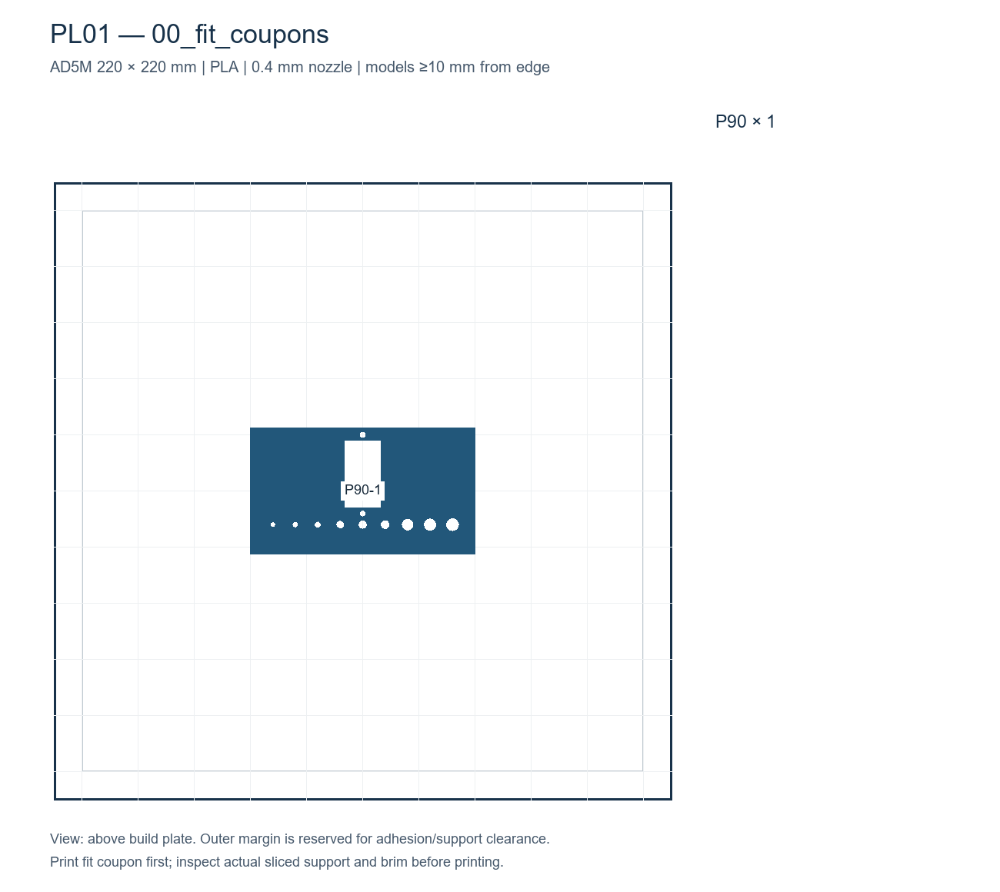

### PL02 arrangement

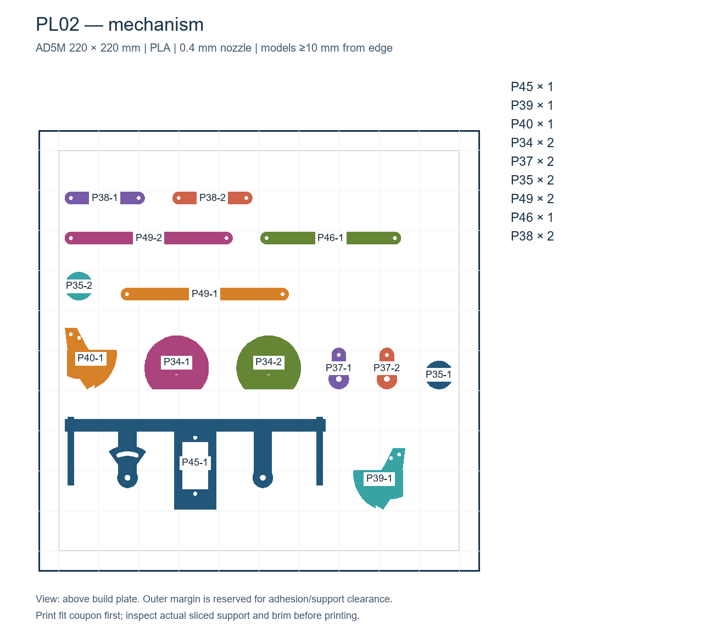

### PL03 arrangement

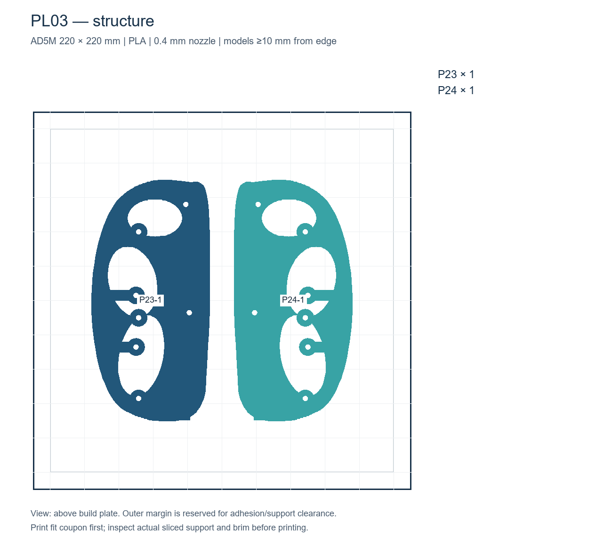

### PL04 arrangement

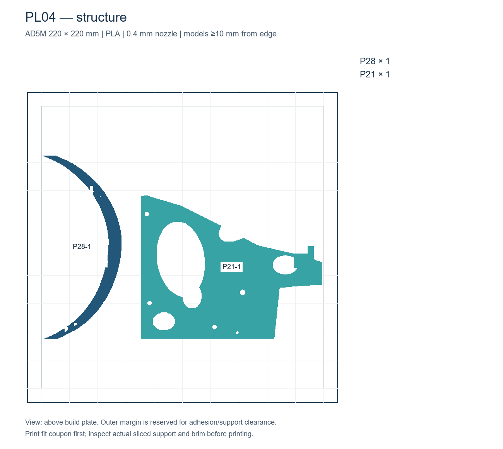

### PL05 arrangement

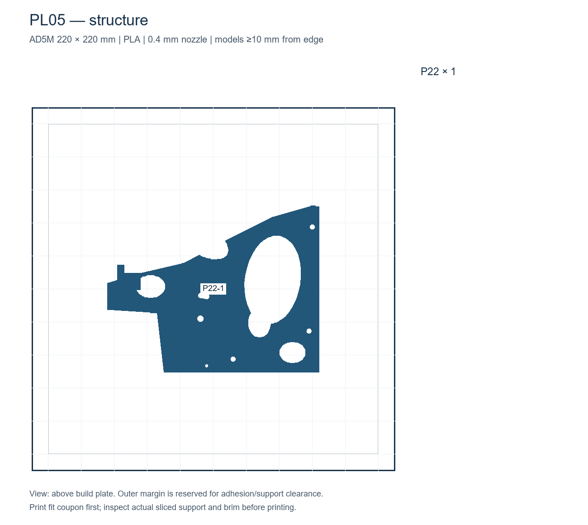

### PL06 arrangement

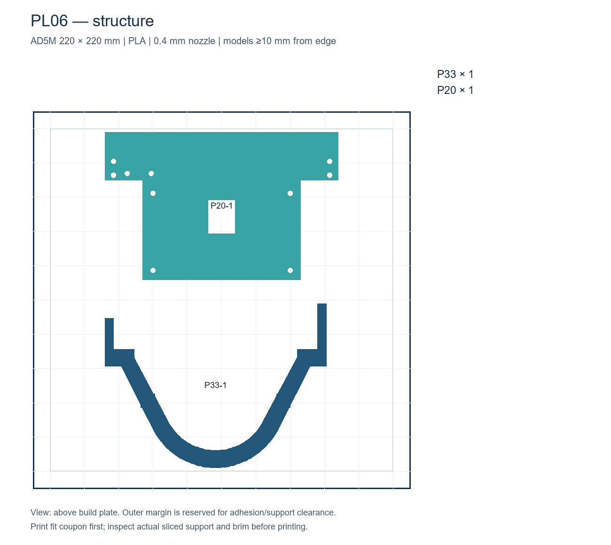

### PL07 arrangement

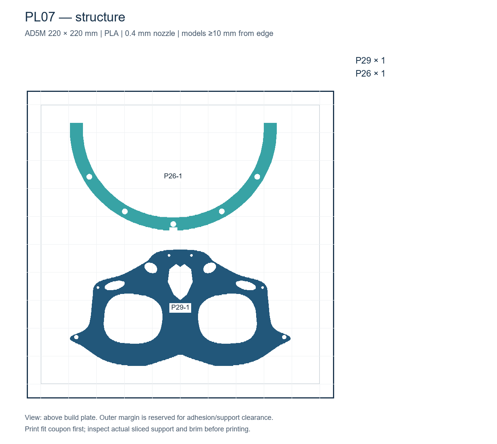

### PL08 arrangement

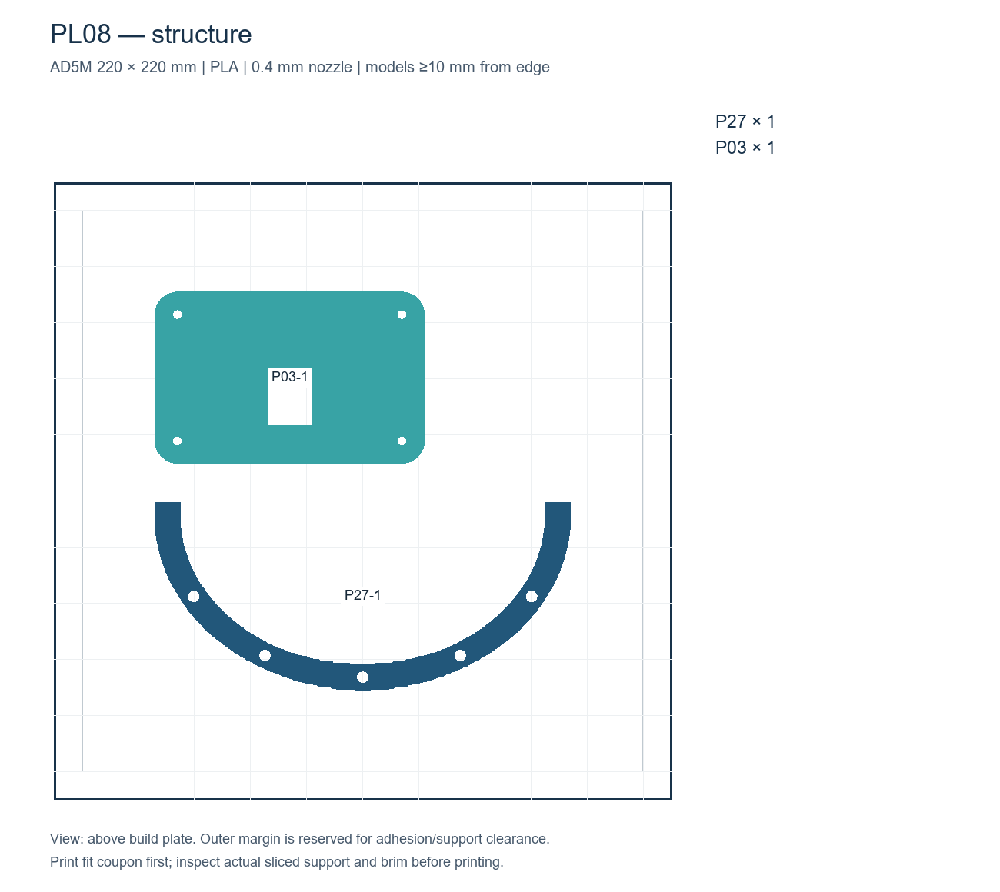

### PL09 arrangement

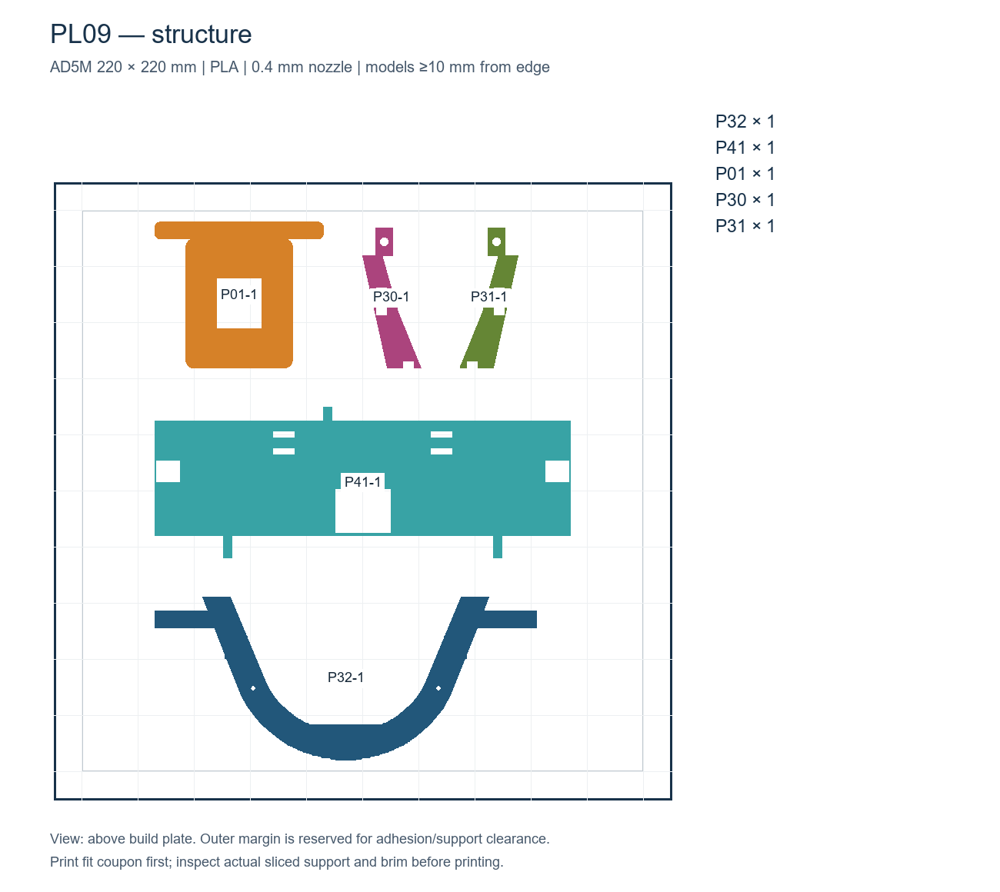

### PL10 arrangement

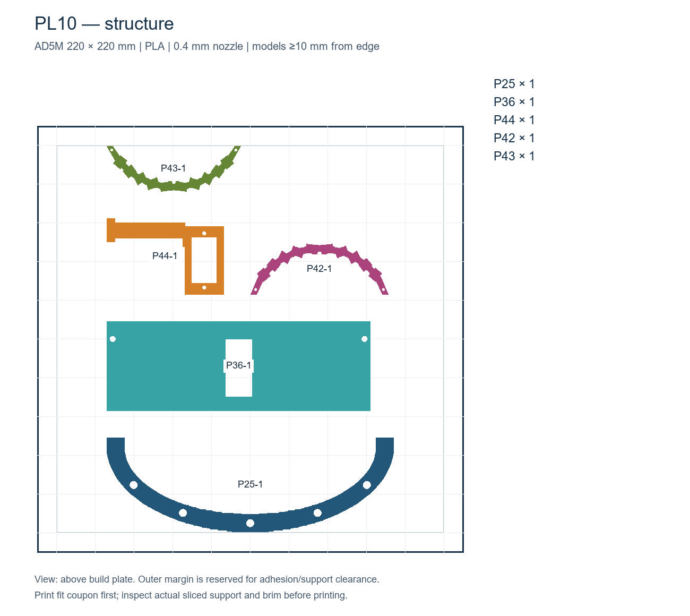

<!-- pagebreak -->
# 6. Mechanical assembly

The following sequence preserves access to internal nuts and pivots. Read the full module step before installing its fasteners. The hardware schedule in section 3 provides exact set quantities, locations and nominal axes. Keep servo power disconnected during mechanical work. Do not force a printed fit or use a servo to overcome binding.

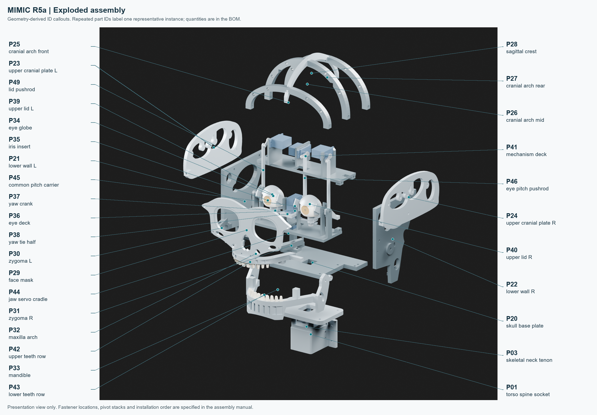

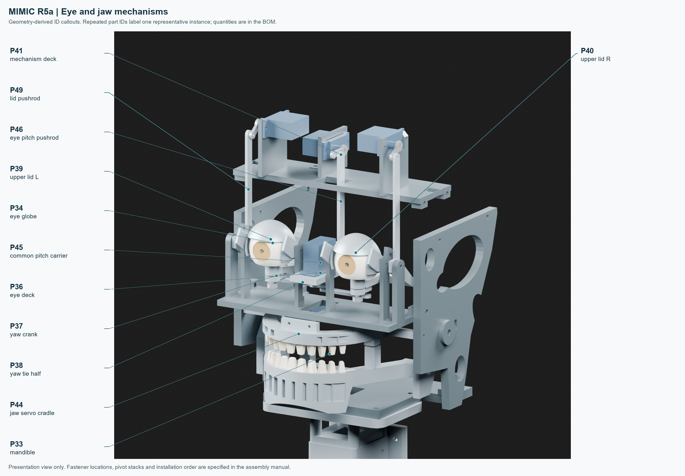

## 6.1 Inventory and fit approval

1. Match every printed component to the section 2 BOM and the plate map. P90 is a bench fit coupon, not a head component. Remove supports from internal bores and channels before inserting hardware. Mark left/right parts on concealed surfaces.
2. Measure the actual servos and OEM horns. The CAD's nominal microservo envelope is not identification of the user's hardware. Verify mounting-hole pitch, body clearance, shaft position, horn radius, horn thickness and spline screw access against the final contract. Any mismatch requires a source change and re-verification before assembly.
3. Trial the coupon holes, nut seats and insert fit with the purchased hardware. Deburr metal shafts and printed edges. Use measured finishing only; record final bore sizes and any rework. Dry-fit the neck and mounting interfaces without forcing them.

## 6.2 Base, walls and jaw-servo cradle

4. Set P20 on a supported bench with its underside accessible. Attach P21 and P22 using H_BASE_P21 and H_BASE_P22, screws from above and nuts below. Keep the base flat while snugging the structural bolts. Do not install P03 yet: it can obstruct underside access.
5. Install P44 with H_JAW_CRADLE_BASE, engaging the two underside nuts before the neck is fitted. Trial the CH1 servo body and tab bolts H_SERVO_JAW. Leave the horn disconnected until detached-servo neutral has been measured in section 8. Confirm the actual cable exit is clear of the base, ramus and neck.
6. Join P23/P24 upper plates to P21/P22 using H_PLATE_P23/H_PLATE_P24, outside heads and inside nuts. Fit P41 with H_DECK_-1/H_DECK_1 before the pitch/lid servos obstruct access to the inner nuts. Fit the structural arches P25/P26/P27 with their H_ARCH sets; defer P28 if it obstructs top access during mechanism work.

## 6.3 Common-pitch eye cassette

7. Secure fixed eye deck P36 to the sidewalls using H_EYE_DECK_-1 and H_EYE_DECK_1. Reach the inside nuts before installing the globes. Check that the deck is seated without twist.
8. Assemble P45 between the fixed supports using H_PITCH_PIVOT_-1 and H_PITCH_PIVOT_1. The screws are stationary and P45 rotates on its running bores. Install the specified washer stack and retained nuts; adjust for the contract's axial play rather than clamping the carrier. Fit H_PITCH_STOP: its M2x12 pin traverses the fixed R14 slot on the left support. Keep the pin sliding freely. Support the carrier while checking free rotation.
9. Install the nominal CH0 yaw servo in P45 with H_SERVO_YAW. This servo moves with the pitch carrier. Route its cable rearward through a flexible service loop; check the loop at both pitch limits. Leave its OEM horn unattached until measured neutral is known.
10. Fit the radial captive nuts in each P34 globe and P37 crank before inserting the 3 mm metal yaw shaft. Insert the diameter 3 x 33 mm H_YAW_SHAFT_-1/H_YAW_SHAFT_1 shafts (neutral Z84..117); retain them with H_YAW_COLLARS (3 mm ID, at most 7 mm OD, 3 mm long). The lower collar occupies Z84..87 and upper collar Z105.2..108.2. Verify the actual collar screw envelope and install the H_GLOBE_CLAMP and H_YAW_CRANK_CLAMP set screws. Use the required local shaft flats. The shaft is clamped separately to globe and crank; it rotates freely in the carrier. Aim both globes forward and align both crank holes rearward before securing the clamps. Verify retention against an axial pull by hand.
11. Install the two P38 tie halves using H_YAW_LINK_LEFT, H_YAW_LINK_RIGHT and H_YAW_LINK_CENTRE. Their planes are staggered as shown in CAD. Use the 1 mm spacer at the left M2x20 pin and 3.5 mm spacer at the right M2x16 pin. The longer left pin also traverses the carrier yaw-stop slot: head above carrier, nut below link. Keep its stop-slot motion free. The center is a single retained OEM horn pin carrying both links. Do not substitute a printed spline. Hand-check both globes stay synchronized without bind throughout the permitted yaw range.
12. Install CH2 pitch servo on P41 with H_SERVO_PITCH. Fit P46 between the common carrier and the OEM pitch horn using H_PITCH_ROD. Preserve the specified rod plane and metal spacer alignment. Connect the horn only after detached-servo calibration and with the carrier physically at its recorded neutral. Check both eye axes manually with the lids absent first.

## 6.4 Upper eyelids

13. Fit P39/P40 to P36 using H_LID_PIVOTS. There are four retained pivots; the washers occupy the specified lid/prong gaps. Set running axial play and confirm each lid rotates independently without being pinched by its pivot screw.
14. Install H_LID_STOP_-1/H_LID_STOP_1 in the fixed curved-slot arrangement. The pin must slide and the nut must remain retained. A stop is a last travel boundary, not an operating position for a powered servo.
15. Attach the CH3/CH4 servos to P41 using H_SERVO_LID_-1/H_SERVO_LID_1. Install the two P49 pushrods with H_LID_RODS and the specified lower/upper metal spacers. Use M2x14 pins with nominal 4.45 mm lower and 1 mm upper metal spacers; verify these against the actual horn thickness. Keep the rods at X = -58.5 and +58.5 mm. Fit each OEM horn at the measured start pose after section 8 calibration. Check lid travel with both eyes at every permitted gaze extreme; a clear lid at center gaze does not prove combined clearance.

## 6.5 Jaw and face

16. Trial P32's side supports using H_MAX_P21/H_MAX_P22 before the jaw blocks access. Keep the teeth absent while checking mechanical travel. Seat the specified heat-set insert in P33 only after its actual outer diameter and installation method have been confirmed using P90. Allow it to cool and inspect for cracks/distortion before applying load.
17. Support P33 and install H_JAW_LEFT_PIVOT from the outboard side. Use one H_JAW_SLEEVE at each side: diameter 4 mm OD / 3.2 mm ID tube, 12.9 +/-0.05 mm long, with square deburred ends. The screw clamps the sleeve to the jaw; the sleeve rotates in the 4.2 mm wall bore. The nominal wall/ramus stack is 12.5 mm, leaving 0.4 mm free axial clearance. Left: one 0.5 mm washer and M3x18 screw into the M3x4 insert; nominal engagement is 3.6 mm and the tip must not intrude into the horn. Right: H_JAW_RIGHT_PIVOT M3x25 screw, two 0.5 mm washers and nyloc nut. Measure the actual stacks before tightening; do not clamp either ramus against a wall.
18. Install H_JAW_STOP through the curved right-wall slot. Check sliding action and both travel boundaries by hand. Couple the measured-neutral CH1 OEM double-arm horn using H_JAW_HORN only if the actual two-hole pattern and spline position match. Retain its OEM center screw. With actuator power off, verify jaw motion is free and does not load a stop or contact the neck.
19. Attach P30/P31 zygoma roots with H_ZYG_ROOT_-1/H_ZYG_ROOT_1. Offer up P29 and retain its side pads using H_FACE_P23/H_FACE_P24, zygoma face bolts H_ZYG_P30/H_ZYG_P31 and lower nasal/maxilla interface H_MAX_FACE. Keep the face removable for service. Verify driver access before tightening the final cosmetic assembly.
20. Fit P42 and P43 teeth using H_TEETH_P42/H_TEETH_P43 at the rear carrier locations. Confirm nut engagement and tooth-to-tooth clearance throughout jaw travel. Trim projecting fasteners only when measured excess is documented and full engagement remains. Retain each P35 iris with two approximately 1 mm dots of neutral-cure flexible RTV at its rim (H_IRIS_RTV). Cure off the mechanism and keep the pupil/LED aperture clean. This is a removable cosmetic joint: cut the dots to replace the insert. Check that neither insert can dislodge into the mechanism.
21. Complete P28's three crest laps with H_CREST. Check all moving-part swept volumes again with the complete cosmetic assembly installed. A successful bare-mechanism sweep does not qualify the assembled face.

## 6.6 Neck interface and harness

22. With the jaw supported and all underside-access work complete, attach P03 to P20 using H_NECK_FLANGE. Preserve the 80 x 45 mm hole pattern and the central harness opening. Insert P03 into P01 without force and fit H_NECK_LOCK through the two cross-lock holes. Check the actual printed fit before fully retaining the head.
23. Keep the head on a stable supported fixture. The recovered torso socket does not establish the strength or fit of an absent torso or active neck. Measure final head mass/center of mass and design the next support module separately before full-body integration.
24. Label both ends of each servo cable CH0-CH4. Route cables through P41's tie slots with removable strain relief and through the neck passage only after confirming connector insertion. Keep power conductors away from I2C/audio runs where practical. Check all service loops across the full manual travel envelope; no cable may become a mechanical stop.
25. Photograph the installed fasteners, pivots and wire routes. Record manual sweep clearances, axial play and stop contact in `physical_verification.csv`. Continue to electrical tests only after the unpowered mechanism is assembled and inspected.

## Horn alignment rule for all five channels

Run detached-servo commissioning from section 8 before connecting a horn/linkage. A 1500 us command does not define a mechanical zero. With the servo at its measured neutral and the mechanism supported at its physical neutral, isolate actuator power and attach the OEM horn at the closest matching spline index. Retain the manufacturer's center screw and connect the appropriate measured pin radius. Recheck the neutral mechanically before enabling the coupled axis. If spline indexing leaves an offset, measure and record the resulting pulse neutral; do not force a linkage to an assumed zero.

The software limits are electrical pulse limits derived during commissioning. The final contract's nominal angular envelope is not a pulse-to-angle conversion. Stops, hardware, tolerances, wiring and actual output movement must be checked together before allowing all-channel motion.


## Nominal motion envelope - physically unverified

| Axis | Operating range (deg) | Geometric stop range (deg) |
| --- | --- | --- |
| Linked yaw | -20 to +20 | -22.99 to +22.99 |
| Linked pitch | -12 to +12 | -14 to +14 |
| Jaw | 0 to 14 | -0.4 to 17.03 |
| Left/right lid | 0 to 50 | -2.99 to 52.99 |

These are final CAD nominal angles, not confirmed physical limits or PWM commands. The jaw closing stop was revised to -0.4 deg to limit overclosure. Measure print error, backlash, tooth clearance and real stop contact before choosing narrower calibrated operating limits. Do not command a servo into a stop.


<!-- pagebreak -->
# Mechanical load and speed assessment

# Conditional load and speed assessment

Revision R5a-E1. Analytical calculation only; no physical test.

| Axis | Moving mass incl. allowance (g) | Screened demand (N m) | Conditional rated stall target (kg cm) | Motor sweep (deg) |
|---|---:|---:|---:|---:|
| jaw | 59.4 | 0.0349 | 1.42 | 14.0 |
| pitch | 87.4 | 0.0121 | 0.49 | 41.8 |
| lid_L | 7.8 | 0.0052 | 0.21 | 53.8 |
| lid_R | 7.8 | 0.0052 | 0.21 | 53.8 |
| yaw | 37.5 | 0.0071 | 0.29 | 40.0 |

Mass uses a chosen 1.25 g/cm3 solid PLA density and explicit purchased-hardware allowances. Gravity follows CAD centers of mass. The output acceleration is assumed 180 deg/s2; inertia uses an enclosing-radius bound. Virtual work converts output load to motor load using the solved linkage derivative. A chosen friction reserve is included. The 4x stall target is a sizing heuristic; it does not establish continuous-duty capability.

The actual servo markings remain uncertain (reported SG950/MG950). Do not substitute a named microservo specification for measured identification. Compare these targets to the real manufacturer curve at the measured rail voltage, then measure current, temperature, lost motion and margin in the assembled mechanism.

A rapid blink requires both closing and reopening strokes. Minimum time is bounded by actual motor sweep divided by measured loaded speed, with extra acceleration time. The firmware is deliberately calibrated in pulse units; no angular speed claim follows until pulse-to-angle measurements are entered.

## Printed linkage strength screening

| Rod | Ideal pinned Euler load with assumed effective E=500 MPa (N) |
|---|---:|
| P46 pitch pushrod | 9.41 |
| P49 eyelid pushrod | 3.28 |

These ideal values omit end holes, print anisotropy, creep and imperfect straightness. Inspect rods and perform a measured compression/tension proof test with at least the chosen design load margin. No printed-part load rating is released from this calculation.

## Outstanding limits

- No measured servo model, torque-speed curve, supply drop, current or thermal data.
- CAD solid-density mass overestimates infill but may miss cables/fasteners; weigh final assemblies.
- First-order inertia bound omits exact coupled linkage dynamics and compliance.
- No FEA, fatigue, screw pullout, spline or clamp strength qualification.
- Pulse-per-degree mapping is unknown; firmware speed in us/s must be calibrated against actual angles.
- Neck load rating and future torso/arm/hand loads are not established.


<!-- pagebreak -->
# 7. Electrical installation

# R5a electrical integration — revision1.0.0

The delivered controller is a five-axis ESP32/PCA9685 commissioning system with outputs disabled by default. Actual servo model numbers and the existing power supply are **unverified**. The user reported `sg950` and `mg950`; these are not silently reinterpreted as SG90/MG90S. Procurement of the final actuator supply, fuse values, connector ratings and servo mount fit remains on hold until markings, dimensions, voltage limits and current data are recorded. This is an explicit physical dependency, not a passed manufacturing check.

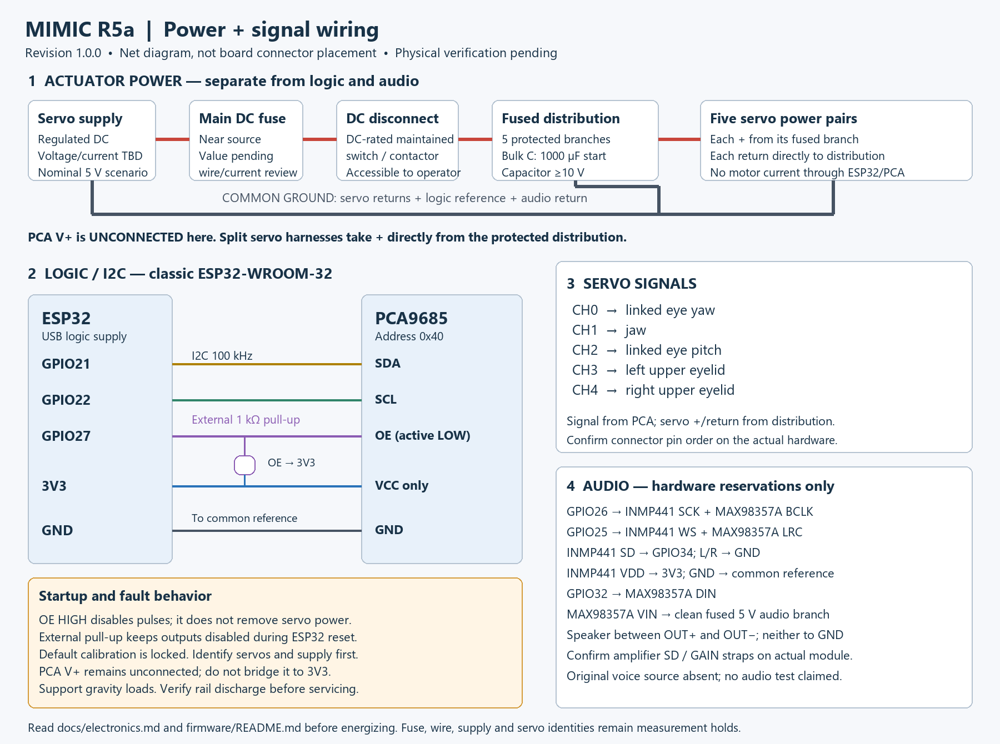

The drawing is an electrical net diagram, not a drawing of an unidentified board's connector positions. Read silkscreen and confirm each actual module pin before wiring. Do not infer servo polarity from wire colors alone.

## Net list

| From | To | Requirement |
|---|---|---|
| ESP32 GPIO21 | PCA SDA | 100kHz I2C; pull-ups to 3V3 only. |
| ESP32 GPIO22 | PCA SCL | Keep short; confirm existing board pull-ups. |
| ESP32 GPIO27 | PCA OE | Active LOW; external 1 kΩ from OE to 3V3. |
| ESP32 3V3 | PCA VCC + INMP441 VDD | Logic supply only. Never connect servo positive here. |
| ESP32 GND | Common ground reference | Bond to distribution ground at one deliberate point. |
| PCA CH0 signal | Eye-yaw servo signal | Shared linked yaw mechanism. |
| PCA CH1 signal | Jaw servo signal | Existing R4 channel preserved. |
| PCA CH2 signal | Eye-pitch servo signal | Linked pitch carrier. |
| PCA CH3 / CH4 signal | Left / right upper lid servo | Independent channels. |
| Regulated actuator rail + | Main fuse → DC disconnect → branch protection → each servo + | See power-sizing hold below. |
| Each servo GND | Distribution return | High-current return goes directly to the rail, not through ESP32/PCA logic wiring. |
| PCA V+ | **Unconnected** in this wiring design | All motor power bypasses unknown PCA PCB traces. Use split harnesses; do not insert a conventional three-wire plug and expect power from V+. |
| ESP32 GPIO26 | INMP441 SCK + MAX98357A BCLK | Reserved audio clock. |
| ESP32 GPIO25 | INMP441 WS + MAX98357A LRC | Reserved audio frame clock. |
| INMP441 SD | ESP32 GPIO34 | GPIO34 is input-only; microphone data input. |
| INMP441 L/R | GND | Left-slot selection; verify actual module. |
| ESP32 GPIO32 | MAX98357A DIN | Reserved audio data output. |
| Clean regulated 5 V audio branch | MAX98357A VIN | Own branch fuse/filter; common reference ground. |
| MAX98357A OUT+ / OUT− | Speaker terminals | Differential outputs; neither connects to GND. Confirm SD/GAIN straps on actual module. |

GPIO0 retains the ESP32 boot strap function and is not used by this sketch. Do not hold it low during reset except for deliberate upload mode. GPIO26/25/34/32 are neither driven nor reconfigured by motion firmware. Actual R4 voice source was absent; only hardware reservations are preserved.

The PCA9685 has an asynchronous active-low output enable; VCC powers logic and V+ on common breakout boards is a separate servo-distribution net. The delivered firmware sets MODE2 so disabled outputs are LOW, verifies pulse-register writes, and drives OE HIGH before fault I2C work. See the [NXP datasheet](https://www.nxp.com/docs/en/data-sheet/PCA9685.pdf) and [Adafruit board power guidance](https://learn.adafruit.com/16-channel-pwm-servo-driver?view=all). A clone board's copper, connector rating and reverse-polarity protection cannot be inferred from another vendor's board.

## Power budget and protection

For five servos, use **I_actuator = sum of each verified peak/stall current at the selected voltage**, with the supply able to handle simultaneous starts and a design margin. Do not apply a duty-cycle reduction when sizing short-circuit protection or unknown peak demand. Deliberately stalling an assembled mechanism is not a suitable current measurement; prefer manufacturer maximum data, then controlled short-duration motor tests with a current-limited source and an appropriate isolated fixture if needed.

| Planning case only | Current calculation | Supply planning envelope |
|---|---|---|
| Five microservos, assumed 1.5 A peak each |5×1.5=7.5A; 25% headroom gives9.375A | Nominal 5 V 10 A actuator rail **only if measured/specification data justify it**. |
| Five larger servos, assumed 3 A peak each |5×3=15A; 25% headroom gives18.75A | Nominal 5 V 20 A example; may still be inadequate for actual hardware. |
| ESP32 logic branch | Allocate 1 A at 5 V including regulator/USB margin | Verify actual board/regulator; supply separately from motors. |
| Audio branch | Allocate 1 A at 5 V as an initial estimate | MAX98357A can output 3.2 W into 4 Ω at 5 V; actual current depends on gain/speaker/audio. |

The 1.5 A and 3 A figures are **engineering scenarios, not measured values or manufacturer claims for the user's servos**. Actual servo voltage may differ; never raise above a verified component's rating. If a shared upstream source is used later, budget the sum of actuator, logic and audio branch loads and check regulator efficiency. For now use separate regulated supplies with common ground. Do not connect an external 5 V rail to an ESP32 USB/5V pin while also connected to a powered host unless the actual board's power-path documentation permits it.

The [MAX98357A manufacturer page](https://www.analog.com/en/products/max98357a.html) specifies 2.5–5.5 V operation and 3.2 W into 4 Ω at 5 V. The [INMP441 datasheet](https://invensense.tdk.com/wp-content/uploads/2015/02/INMP441.pdf) supports a 3.3 V supply; it must not be powered from the actuator 5 V rail. The [ESP32 pin documentation](https://www.espressif.com/sites/default/files/1a-esp32_pin_list_en-v0.1.pdf) identifies GPIO34 as input-only.

Select wire and protection after measuring cable lengths and establishing peak demand:

1. Set a servo-terminal voltage-drop allowance, provisionally 0.25 V maximum at the approved peak current unless the servo specification requires less. Compute the **whole loop**: ΔV=I×(R_positive+R_return+R_connectors). Include upstream and each branch. Example only: a 0.5 m one-way copper pair at a nominal 21 mΩ/m gives0.1575V drop at 7.5 A before connector resistance. This calculation is not an ampacity approval.
2. Select insulation temperature rating, conductor size, connector and terminal ratings for the actual bundling, ambient temperature, continuous current and fault exposure. Check vendor ratings. Signal jumper wire and solderless breadboards must not carry the servo bus current.
3. Put the main DC fuse near the source. Choose its time-current curve above measured startup demand but below the smallest protected cable/connector's safe fault capability. Verify the source's fault current, fuse interrupt rating and time to clear. Protect each smaller servo branch independently; a large main fuse may not protect its small wires. No final fuse value is released here.
4. Use a maintained, accessible **DC-rated actuator-power switch or contactor**. It interrupts servo positive. An optional separate normally-closed enable loop may also force OE high; the delivered design does not claim a safety-rated emergency-stop circuit.
5. Start with 1000 µF / ≥10 V low-ESR bulk capacitance at the servo distribution, plus module-specified local decoupling. Check inrush, polarity and measured droop. A capacitor does not replace an adequately rated supply. For scale, C=IΔt/ΔV: 7.5 A for 1 ms with 0.25 V allowable droop requires 30,000 µF, far above 1000µF. Use measured dynamics to tune the supply/harness.
6. Keep grounds common but route actuator current in its own paired conductors. Route I2C and audio away from motor loops, provide strain relief at every removable module, and leave verified service loops outside all swept volumes. Label both ends CH0–CH4. Do not use structural bolts as electrical return conductors.

After disconnecting, stored capacitor energy may briefly keep the bus energized. Verify the rail is discharged before servicing. OE removes pulses, not power, and may release gravity-loaded mechanisms; support the head and jaw.

## Bench acceptance matrix — all physical results pending

| Test | Setup and action | Acceptance / record |
|---|---|---|
| Polarity/continuity | All supplies disconnected; inspect connectors, fuse/branch routing and common ground. | No short between rails; no servo + to 3V3; correct speaker differential connection; record actual pinout. |
| Logic reset | Servo power off; boot/reset ESP32 and disconnect/reconnect USB. Measure OE and CH0–4. | OE stays HIGH until explicit command; no unexpected pulses. Record scope traces including reset transitions. |
| Clock/pulse | Detached servo or scope-only load; command 1500 us and adjacent values. | Measure period, quantization and pulse width. Update oscillator constant before endpoint calibration. |
| One-servo identification | Detached horn; current-limited verified voltage. | Confirm positional response, current, neutral, travel direction and no overheating. Repeat all five. |
| Command timeout | Enable detached servo then stop all serial commands. | OE goes HIGH after lease expiry; record actual timing and servo reaction. Firmware threshold 3 s, not a guaranteed physical stop time. |
| I2C loss/corruption | In a controlled bench setup, interrupt SDA/SCL or PCA logic; keep load safe. | Fault/OE HIGH; no automatic restart. Record worst observed delay. Mock tests are not this physical test. |
| CPU reset/watchdog | Detached/supported mechanism; force reset and controlled task stall in a test build. | External pull-up disables pulses; verify controller recovery remains OFF. |
| Servo-rail dip | Current-limited lab supply; reproduce expected transient/dip while observing rails and OE. | No controller reset/uncommanded restart or damaging latch-up. Servo behavior during lost power may require added hardware supervision. |
| Logic brownout | Servo mechanically isolated/supported; vary logic input within board limits. | OE remains/returns HIGH; no unintended pulses; record any failure. |
| Emergency power isolation | Supervised slow motion; use physical disconnect. | Actuator rail collapses, motion behavior documented, logic remains available; stored energy/discharge time recorded. |
| Load and thermal | Measured calibrated range, slow motion, then duty-cycle run. | Current below approved ratings; voltage stays in servo specification; no abnormal heating, gear chatter or PLA deformation. Record temperatures and duration. |
| Combined-axis clearance | Mechanism assembled, wires retained, full measured envelope. | No contact, bind or wire pinch. Set mechanical-review gate only after this and the mechanical checklist pass. |
| Audio coexistence | Only after original voice source is obtained/ported; simultaneous sound and motion. | No timing overruns, I2C faults, reset, noise-induced motion or audio failure. Not performed by this release. |

No physical result is marked passed in this package. Calibration entries remain blank and the shipped motion gates remain false. Future torso/arms/hands must use separately budgeted power domains and local control/fault handling; do not add large actuators to this head's unverified bus.


<!-- pagebreak -->
# 8. Flash, calibrate and commission

# Mimic R5a motion firmware — 1.0.0

This is new commissioning firmware, compiled for a **classic ESP32-WROOM-32 / ESP32 Dev Module**. It retains the reported R4 PCA9685 pin/channel interface. The original R4 motion and voice source packages were not supplied, so this is not a verified merge with those programs. No live board was flashed or physically tested. The release is deliberately unable to arm the assembled head until measured calibration is entered.

## Build and flash

Dependencies: Arduino CLI 1.5.1 used for the recorded build; Arduino-ESP32 **2.0.17**, FQBN `esp32:esp32:esp32`. Only core-supplied Wire and watchdog APIs are used. No external Arduino library is required. Keep core 2.0.17 for future legacy I2S voice compatibility; core 3.x requires a deliberate port.

From the release folder, after installing Arduino CLI:

```powershell
arduino-cli core update-index --additional-urls https://espressif.github.io/arduino-esp32/package_esp32_index.json
arduino-cli core install esp32:esp32@2.0.17 --additional-urls https://espressif.github.io/arduino-esp32/package_esp32_index.json
arduino-cli compile --fqbn esp32:esp32:esp32 --build-path "$env:TEMP/Mimic_R5a_build" firmware/Mimic_R5a
arduino-cli board list
```

Keep servo power disconnected during upload. Select the actual listed port; `COM7` below is an example, not an identified device:

```powershell
arduino-cli upload --fqbn esp32:esp32:esp32 --port COM7 --input-dir "$env:TEMP/Mimic_R5a_build" firmware/Mimic_R5a
arduino-cli monitor --port COM7 --config baudrate=115200
```

Alternatively open `Mimic_R5a/Mimic_R5a.ino` in Arduino IDE, select the pinned core and ESP32 Dev Module. Do not choose an ESP32-C3/S3 board for this pin map. No compiled binary is supplied: build the source with the calibration intended for that head.

## States and commands

Use newline-terminated commands, 115200 baud. Commands are case-sensitive. Boot, reset, fault and demo completion disable outputs. `off` disables OE **before** attempting I2C writes. Unknown commands while active fault the controller. A fault requires explicit `off` or `reset`; it never automatically restarts.

| Command | Action / prerequisite |
|---|---|
| `status` | Display state and target pulses; does not renew lease. |
| `off` | Immediate OE HIGH, all PCA channels full-off, cancel demo. |
| `reset` | Reinitialize PCA only while inactive; OE remains HIGH. |
| `commission 0 FREE` | Enable only CH0 at 1500 us. Replace 0 with 0–4. The word FREE confirms the horn/linkage is detached or the start pose is physically proved free. |
| `set 0 1505` | Slew the selected axis toward an integer pulse in its current permitted range. All other enabled axes retain their targets. |
| `ping` | Renew the 3 s external command lease. Send at least once each second while motion remains enabled. |
| `arm PARKED` | Enable all five at their **measured neutral** pulses, only after all calibration/review gates pass and the mechanism is physically parked. |
| `demo` | Twenty-second, slow coordinated neutral/low/neutral/high/neutral sequence. Excursion is 15% toward each measured endpoint. Keep sending `ping`; internal demo targets do not renew the lease. |

`commission` defaults to 1400–1600 us, 20 us/s and 40 us/s². Calibrated default caps are 30 or 40 us/s and 60 or 80 us/s² by axis. These are **electrical command limits, not measured angular speeds**. Actual PWM quantization is about 4.88 us/tick at the nominal oscillator, so very small pulse commands can produce the same output tick. Continuous internal profiles limit velocity and acceleration; a physical servo may still jump, stall or lose tracking. A 1500 us pulse does not imply a known mechanical angle.

## Commission one detached servo first

1. Identify each actual servo marking, voltage, connector polarity, dimensions and spline. The user's `sg950` / `mg950` names are unresolved; do not substitute MG90S or SG90 data without identification. Resolve the supply and protection in `docs/electronics.md` before powering actuators.
2. Wire the 1 kΩ OE pull-up to 3V3. With servo supply OFF, power ESP32/PCA logic. Measure OE HIGH during boot/reset. Verify I2C address 0x40. Check the physical emergency servo-power disconnect.
3. Remove the first servo's horn/linkage or prove the commanded start cannot hit anything. Power only that servo from a current-limited supply within its specified voltage. Send `commission 0 FREE`, then periodic `ping`. At 1500 us inspect for unexpected rotation/current. Use `off` immediately if either occurs.
4. Measure PCA pulse and period with a scope/logic analyzer. Nominal prescale 121 with 25 MHz oscillator gives 50.0288 Hz. If measured oscillator differs, update `kPcaOscillatorHz` before collecting calibration. The prescale is explicit and pulses use its real nominal period; no generic us/degree conversion is used.
5. Use `set 0 1505`, observe, then widen in 5 us target increments. Check free travel, load current and heat at each step. `kCommissionMinimumUs`/`MaximumUs` may be expanded **10–20 us at a time**, only after the previous range is physically checked. Rebuild/reflash with servo supply OFF. The 900–2100 us absolute software envelope is not a servo specification.
6. While the servo is holding the measured assembly neutral, install its OEM horn, retain the OEM spline screw, and attach linkage with actuator power isolated. Manually support the mechanism against dropping. Repeat with the linkage assembled, one channel at a time and a narrower safe range. Enter any off-state neutral carefully: re-enabling does not know actual position.
7. Measure the output angle with an angle gauge at both permitted limits and neutral. Stop short of the mechanism stops, allowing measured backlash, elastic flex and PWM quantization. Record pulses, actual output angles, direction, supply voltage/current and clearance in `calibration_record.csv`. Check the final mechanical contract; nominal yaw/pitch/jaw/lid angles are not pulse conversions.
8. Set each `AxisCalibration` row to the **measured** minimum/neutral/maximum pulses and `measured=true`. A neutral is allowed at an endpoint (e.g. jaw closed), but minimum must be less than maximum. Keep the measured caps conservative. The source rejects caps above 100 us/s or 200 us/s²; increases beyond those require engineering review and tests.
9. Validate every permitted combined corner pose, cables, stops, lid/globe spacing, jaw/neck clearance and load current. Only then set `kMechanicalReviewAccepted=true`. This gate asserts the full five-dimensional calibrated envelope is physically acceptable; separate single-axis tests alone do not establish it.
10. Place all axes physically at their recorded neutral, support the head, send `arm PARKED`, keep `ping` running, then request `demo`. Observe the slow sequence before increasing excursion/speed. Do not run unattended.

## Fault behavior and limitations

- A missing external command for more than 3 s, main-loop gap over 100 ms, I2C NACK/readback mismatch, PCA mode/prescale change, invalid target, invalid active command or line overflow disables OE. Every PWM batch checks MODE1 auto-increment/sleep bits, MODE2 and PRE_SCALE before writing pulses; this includes the batch before OE is enabled. Pin/channel constants are in `PinMap.h`.
- A 2 s task watchdog resets a hung CPU; the external pull-up then holds OE high. No software or this non-safety-rated controller guarantees a stop time under every electrical fault. PCA9685 continues generating pulses independently of the ESP32 until OE changes or servo power is removed.
- OE disables control pulses, **not servo power**. Behavior after lost pulses depends on the actual servo. Gravity loads can fall when torque is removed. Use the physical actuator-power disconnect and supports for work near moving parts.
- There is no encoder, limit-switch, current or voltage feedback. Firmware cannot detect a jam, stripped horn, stalled servo, wrong neutral, physical stop contact or servo-supply dip. The supplied electrical design therefore requires supervised bench validation; it is not a protective control system.
- The I2S pins26/25/34/32 are reserved and untouched. No network, cloud credential, microphone capture, speaker playback, audio check or voice integration is claimed. Import the actual voice source later, retain this motion supervisor, then compile and repeat fault/timing tests under audio load.

## Verification

`validation/firmware_compile.log` records the real ESP32 build. The host tests compile the shared motion core and the **actual sketch** against mocked Arduino/Wire interfaces. Re-run from the release folder with Python and g++:

```powershell
python scripts/test_firmware.py --build-dir "$env:TEMP/Mimic_R5a_host_tests"
```

Covered behaviors include default calibration lock, single-channel enable, range rejection, acceleration/speed limits through reversal, five-channel movement, timeout and millis wrap, loop overrun, startup full-off, invalid serial commands, I2C faults/readback corruption, demo lease behavior and off/reset recovery. Mocks do not establish real pin timing, electrical protection, waveform accuracy, loaded servo behavior or mechanical safety.

Physical bench acceptance must include the matrix in `docs/electronics.md`. Record measured results before marking any item physically passed.

Official references: [Arduino ESP32 2.0.17](https://github.com/espressif/arduino-esp32/releases/tag/2.0.17), [NXP PCA9685 datasheet](https://www.nxp.com/docs/en/data-sheet/PCA9685.pdf), [legacy ESP-IDF I2S API](https://docs.espressif.com/projects/esp-idf/en/v4.4.2/esp32/api-reference/peripherals/i2s.html).


<!-- pagebreak -->
# 9. Physical acceptance and maintenance

## Required physical verification

All initial physical results are **NOT TESTED**. Use `physical_verification.csv` for the build serial number, inspector, date, instruments, measured values and evidence references. Re-run affected checks after changing a printed part, servo, supply, horn index, firmware calibration or motion limit.

1. Confirm hardware identity and supply ratings. Measure body/tab/horn dimensions and connector polarity before committing actuator mount prints. Verify the reference neck interface against the real intended mating part.
2. Print coupons and measure every specified fit. Reject cracked, warped or delaminated parts. Record any drilling/reaming; do not alter an interference blindly.
3. Assemble unpowered. Verify every axle and spline screw is retained, every nut has full engagement, pivots rotate without binding, and tools can reach service fasteners.
4. Move the jaw, eye mechanism and lids manually through their permitted ranges. Check combined extreme poses, tooth clearance, full cable service loops and hard-stop contact. Do not use servo stall to find a stop.
5. Complete electrical continuity, polarity and logic-only reset checks before powering one detached servo. Verify the physical actuator disconnect and OE behavior separately; OE does not remove motor power.
6. Record per-axis measured neutral/end pulses and angles, current, rail voltage, backlash and clearance at conservative speeds. Complete the five-axis combined-envelope review before accepting the firmware mechanical gate.
7. Run the fault checks in section 7 with supported or detached loads. Record timeout, reset, I2C loss and power loss behavior on the real hardware.
8. Run a supervised 100-cycle low-excursion screening sequence, then inspect screws, pivots, printed layers, temperatures and cable wear. The cycle count is an initial commissioning screen, not a service-life rating. Set the next inspection interval from observed wear/load history.
9. Record the final build mass and center-of-mass estimate before considering neck/torso integration. The static socket is not a rated active-neck or humanoid support system. Arms and piano-playing hands require their own actuator, structural and feedback design.

## Troubleshooting

| Observation | Check and corrective action |
| --- | --- |
| `arm PARKED` rejected | Expected until all five measured calibrations and the mechanical-review gate are valid. Do not bypass the gate to make the demonstration run. |
| Servo jumps on enable | Switch off actuator power, support the mechanism and detach the horn. Recheck measured neutral, OEM horn index, pulse waveform and physical parked position. Software cannot know off-state position. |
| Motion stops after about 3 s | External command lease expired. During an intentional bench test send `ping` at least once each second; do not disable timeout protection. |
| Clicking, high current or no motion | Remove actuator power immediately. Check obstruction, hard-stop contact, pivot clamping, cable snag, wrong horn length and stripped spline before retrying. |
| Eye mismatch or excess backlash | Check pinned linkage retention, axle fits, tie-bar length and neutral indexing. A loose drive joint must be repaired before widening limits. |
| Lid rubs or misses coverage | Inspect the actual globe/lid gap at combined gaze extremes; remove paint/support residue from the swept path and verify pivot stack. Do not force clearance by servo torque. |
| Jaw droops or hits neck | Support jaw, isolate actuators and inspect retention and measured limits. Recheck load/current and collision path; never expand to historical 22 deg based on the old brief. |
| ESP32 resets or audio crackles | Measure rail droop and ground routing. Check separate power branches, conductor/connector ratings and transient demand. A larger capacitor alone does not resolve an undersized supply. |
| Loose printed mount | Inspect cracks, compression and fastener engagement. Replace damaged PLA; do not keep tightening until deformation stops. |

## Maintenance and disassembly

Before each session, inspect visible fasteners, servo spline screws, pivot retention, cracks, harness slack and the accessible actuator-power disconnect. Stop if a joint shifts, current rises, or a new noise appears.

For service, park if motion is still reliable, support the head and jaw, switch off the actuator rail, disconnect logic/audio supplies, and verify stored capacitor voltage has discharged. Label connectors before unplugging. Remove cosmetic parts first and work backward through the numbered module assembly steps. Keep pivot spacers and retained hardware with their module.

Do not solvent-clean PLA, heat it to reshape a precision joint, or lubricate electrical connectors. Clean dust with a soft brush. Replace damaged pivots, worn holes, cracked links and frayed cables. Record rework and re-run calibration/combined-envelope checks after replacing any motion component.

Maintain a build history containing source revision/hash, printed material/profile, measured fit results, servo identities, supply specification, calibration record, firmware build and observed wear. Keep the initial R5a concept archive unchanged as provenance; it is not the manufacturing master for revised parts.


<!-- FINAL_RELEASE_ADDENDUM -->

# Final release check — R5a-E1

The final P36 eye-deck revision enlarges an existing hidden rear relief in the inner support posts. It removes 135 mm3 and preserves a valid single solid, bearing axes, fastening locations and the approved exterior. No other positioned assembly solid changed.

The prior 361-pose collision check found no solid intersections. For the final relief, the old solid was cut with the expanded tool and its volume and surface samples compared with the new STEP. All other assembly bodies were compared directly. Removing fixed material cannot create an intersection with the unchanged moving bodies. Thirty targeted yaw-link clearance measurements give a minimum 1.316 mm at the checked positions. See validation/final_clearance_amendment.json; this is not a claim of a new full 361-pose run or continuous swept-volume proof.

P36 STL and individual/grouped 3MF geometry were refreshed. Only PL10 required reslicing; the nine unchanged slice projects were retained. Final quantities are 31 unique designs, 36 pieces including one fit coupon, on ten plates. P36's current manufacturing drawing shows the final relief. Assembly presentation images show the preceding hidden-relief edge; exterior, assembly locations and hardware are unchanged, and the manufacturing STEP/drawing governs that local edge.

FlashPrint application compatibility is unverified. Standard geometry 3MF containers and actual OrcaSlicer projects are provided separately. Structure, geometry, quantities, orientation and AD5M bed/toolpath boundaries are checked; successful FlashPrint import or printing has not been tested.

Firmware, electrical wiring and channel assignments are retained. The firmware compile and 5,446 host assertions are existing digital evidence. Outputs default OFF and assembled motion stays locked until measured calibration. Actual SG950/MG950 markings, servo dimensions/horns, supply and protection ratings remain unresolved. Original standalone R4 and working voice source were not supplied.

No physical print, assembly, powered motion, load/temperature or endurance test has been performed. Complete the fit coupon, unpowered sweep, fastener/cable inspection and electrical/motion commissioning records before routine operation.
