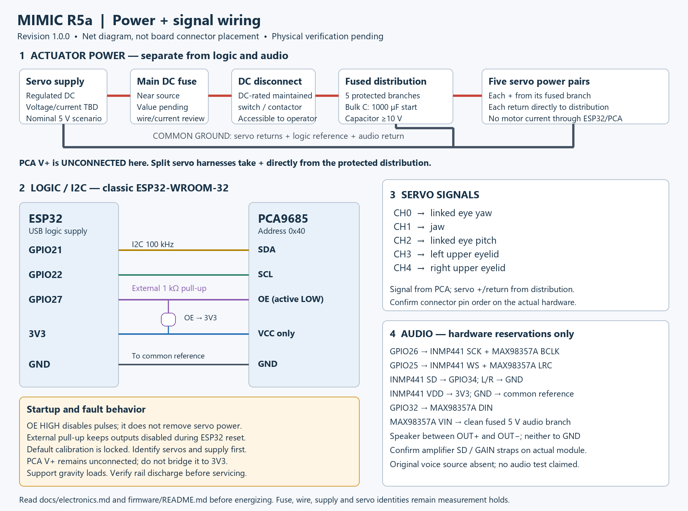

# R5a electrical integration — revision1.0.0

The delivered controller is a five-axis ESP32/PCA9685 commissioning system with outputs disabled by default. Actual servo model numbers and the existing power supply are **unverified**. The user reported `sg950` and `mg950`; these are not silently reinterpreted as SG90/MG90S. Procurement of the final actuator supply, fuse values, connector ratings and servo mount fit remains on hold until markings, dimensions, voltage limits and current data are recorded. This is an explicit physical dependency, not a passed manufacturing check.

The drawing is an electrical net diagram, not a drawing of an unidentified board's connector positions. Read silkscreen and confirm each actual module pin before wiring. Do not infer servo polarity from wire colors alone.

## Net list

| From | To | Requirement |
|---|---|---|
| ESP32 GPIO21 | PCA SDA | 100kHz I2C; pull-ups to 3V3 only. |
| ESP32 GPIO22 | PCA SCL | Keep short; confirm existing board pull-ups. |
| ESP32 GPIO27 | PCA OE | Active LOW; external 1 kΩ from OE to 3V3. |
| ESP32 3V3 | PCA VCC + INMP441 VDD | Logic supply only. Never connect servo positive here. |
| ESP32 GND | Common ground reference | Bond to distribution ground at one deliberate point. |
| PCA CH0 signal | Eye-yaw servo signal | Shared linked yaw mechanism. |
| PCA CH1 signal | Jaw servo signal | Existing R4 channel preserved. |
| PCA CH2 signal | Eye-pitch servo signal | Linked pitch carrier. |
| PCA CH3 / CH4 signal | Left / right upper lid servo | Independent channels. |
| Regulated actuator rail + | Main fuse → DC disconnect → branch protection → each servo + | See power-sizing hold below. |
| Each servo GND | Distribution return | High-current return goes directly to the rail, not through ESP32/PCA logic wiring. |
| PCA V+ | **Unconnected** in this wiring design | All motor power bypasses unknown PCA PCB traces. Use split harnesses; do not insert a conventional three-wire plug and expect power from V+. |
| ESP32 GPIO26 | INMP441 SCK + MAX98357A BCLK | Reserved audio clock. |
| ESP32 GPIO25 | INMP441 WS + MAX98357A LRC | Reserved audio frame clock. |
| INMP441 SD | ESP32 GPIO34 | GPIO34 is input-only; microphone data input. |
| INMP441 L/R | GND | Left-slot selection; verify actual module. |
| ESP32 GPIO32 | MAX98357A DIN | Reserved audio data output. |
| Clean regulated 5 V audio branch | MAX98357A VIN | Own branch fuse/filter; common reference ground. |
| MAX98357A OUT+ / OUT− | Speaker terminals | Differential outputs; neither connects to GND. Confirm SD/GAIN straps on actual module. |

GPIO0 retains the ESP32 boot strap function and is not used by this sketch. Do not hold it low during reset except for deliberate upload mode. GPIO26/25/34/32 are neither driven nor reconfigured by motion firmware. Actual R4 voice source was absent; only hardware reservations are preserved.

The PCA9685 has an asynchronous active-low output enable; VCC powers logic and V+ on common breakout boards is a separate servo-distribution net. The delivered firmware sets MODE2 so disabled outputs are LOW, verifies pulse-register writes, and drives OE HIGH before fault I2C work. See the [NXP datasheet](https://www.nxp.com/docs/en/data-sheet/PCA9685.pdf) and [Adafruit board power guidance](https://learn.adafruit.com/16-channel-pwm-servo-driver?view=all). A clone board's copper, connector rating and reverse-polarity protection cannot be inferred from another vendor's board.

## Power budget and protection

For five servos, use **I_actuator = sum of each verified peak/stall current at the selected voltage**, with the supply able to handle simultaneous starts and a design margin. Do not apply a duty-cycle reduction when sizing short-circuit protection or unknown peak demand. Deliberately stalling an assembled mechanism is not a suitable current measurement; prefer manufacturer maximum data, then controlled short-duration motor tests with a current-limited source and an appropriate isolated fixture if needed.

| Planning case only | Current calculation | Supply planning envelope |
|---|---|---|
| Five microservos, assumed 1.5 A peak each |5×1.5=7.5A; 25% headroom gives9.375A | Nominal 5 V 10 A actuator rail **only if measured/specification data justify it**. |
| Five larger servos, assumed 3 A peak each |5×3=15A; 25% headroom gives18.75A | Nominal 5 V 20 A example; may still be inadequate for actual hardware. |
| ESP32 logic branch | Allocate 1 A at 5 V including regulator/USB margin | Verify actual board/regulator; supply separately from motors. |
| Audio branch | Allocate 1 A at 5 V as an initial estimate | MAX98357A can output 3.2 W into 4 Ω at 5 V; actual current depends on gain/speaker/audio. |

The 1.5 A and 3 A figures are **engineering scenarios, not measured values or manufacturer claims for the user's servos**. Actual servo voltage may differ; never raise above a verified component's rating. If a shared upstream source is used later, budget the sum of actuator, logic and audio branch loads and check regulator efficiency. For now use separate regulated supplies with common ground. Do not connect an external 5 V rail to an ESP32 USB/5V pin while also connected to a powered host unless the actual board's power-path documentation permits it.

The [MAX98357A manufacturer page](https://www.analog.com/en/products/max98357a.html) specifies 2.5–5.5 V operation and 3.2 W into 4 Ω at 5 V. The [INMP441 datasheet](https://invensense.tdk.com/wp-content/uploads/2015/02/INMP441.pdf) supports a 3.3 V supply; it must not be powered from the actuator 5 V rail. The [ESP32 pin documentation](https://www.espressif.com/sites/default/files/1a-esp32_pin_list_en-v0.1.pdf) identifies GPIO34 as input-only.

Select wire and protection after measuring cable lengths and establishing peak demand:

1. Set a servo-terminal voltage-drop allowance, provisionally 0.25 V maximum at the approved peak current unless the servo specification requires less. Compute the **whole loop**: ΔV=I×(R_positive+R_return+R_connectors). Include upstream and each branch. Example only: a 0.5 m one-way copper pair at a nominal 21 mΩ/m gives0.1575V drop at 7.5 A before connector resistance. This calculation is not an ampacity approval.
2. Select insulation temperature rating, conductor size, connector and terminal ratings for the actual bundling, ambient temperature, continuous current and fault exposure. Check vendor ratings. Signal jumper wire and solderless breadboards must not carry the servo bus current.
3. Put the main DC fuse near the source. Choose its time-current curve above measured startup demand but below the smallest protected cable/connector's safe fault capability. Verify the source's fault current, fuse interrupt rating and time to clear. Protect each smaller servo branch independently; a large main fuse may not protect its small wires. No final fuse value is released here.
4. Use a maintained, accessible **DC-rated actuator-power switch or contactor**. It interrupts servo positive. An optional separate normally-closed enable loop may also force OE high; the delivered design does not claim a safety-rated emergency-stop circuit.
5. Start with 1000 µF / ≥10 V low-ESR bulk capacitance at the servo distribution, plus module-specified local decoupling. Check inrush, polarity and measured droop. A capacitor does not replace an adequately rated supply. For scale, C=IΔt/ΔV: 7.5 A for 1 ms with 0.25 V allowable droop requires 30,000 µF, far above 1000µF. Use measured dynamics to tune the supply/harness.
6. Keep grounds common but route actuator current in its own paired conductors. Route I2C and audio away from motor loops, provide strain relief at every removable module, and leave verified service loops outside all swept volumes. Label both ends CH0–CH4. Do not use structural bolts as electrical return conductors.

After disconnecting, stored capacitor energy may briefly keep the bus energized. Verify the rail is discharged before servicing. OE removes pulses, not power, and may release gravity-loaded mechanisms; support the head and jaw.

## Bench acceptance matrix — all physical results pending

| Test | Setup and action | Acceptance / record |
|---|---|---|
| Polarity/continuity | All supplies disconnected; inspect connectors, fuse/branch routing and common ground. | No short between rails; no servo + to 3V3; correct speaker differential connection; record actual pinout. |
| Logic reset | Servo power off; boot/reset ESP32 and disconnect/reconnect USB. Measure OE and CH0–4. | OE stays HIGH until explicit command; no unexpected pulses. Record scope traces including reset transitions. |
| Clock/pulse | Detached servo or scope-only load; command 1500 us and adjacent values. | Measure period, quantization and pulse width. Update oscillator constant before endpoint calibration. |
| One-servo identification | Detached horn; current-limited verified voltage. | Confirm positional response, current, neutral, travel direction and no overheating. Repeat all five. |
| Command timeout | Enable detached servo then stop all serial commands. | OE goes HIGH after lease expiry; record actual timing and servo reaction. Firmware threshold 3 s, not a guaranteed physical stop time. |
| I2C loss/corruption | In a controlled bench setup, interrupt SDA/SCL or PCA logic; keep load safe. | Fault/OE HIGH; no automatic restart. Record worst observed delay. Mock tests are not this physical test. |
| CPU reset/watchdog | Detached/supported mechanism; force reset and controlled task stall in a test build. | External pull-up disables pulses; verify controller recovery remains OFF. |
| Servo-rail dip | Current-limited lab supply; reproduce expected transient/dip while observing rails and OE. | No controller reset/uncommanded restart or damaging latch-up. Servo behavior during lost power may require added hardware supervision. |
| Logic brownout | Servo mechanically isolated/supported; vary logic input within board limits. | OE remains/returns HIGH; no unintended pulses; record any failure. |
| Emergency power isolation | Supervised slow motion; use physical disconnect. | Actuator rail collapses, motion behavior documented, logic remains available; stored energy/discharge time recorded. |
| Load and thermal | Measured calibrated range, slow motion, then duty-cycle run. | Current below approved ratings; voltage stays in servo specification; no abnormal heating, gear chatter or PLA deformation. Record temperatures and duration. |
| Combined-axis clearance | Mechanism assembled, wires retained, full measured envelope. | No contact, bind or wire pinch. Set mechanical-review gate only after this and the mechanical checklist pass. |
| Audio coexistence | Only after original voice source is obtained/ported; simultaneous sound and motion. | No timing overruns, I2C faults, reset, noise-induced motion or audio failure. Not performed by this release. |

No physical result is marked passed in this package. Calibration entries remain blank and the shipped motion gates remain false. Future torso/arms/hands must use separately budgeted power domains and local control/fault handling; do not add large actuators to this head's unverified bus.
