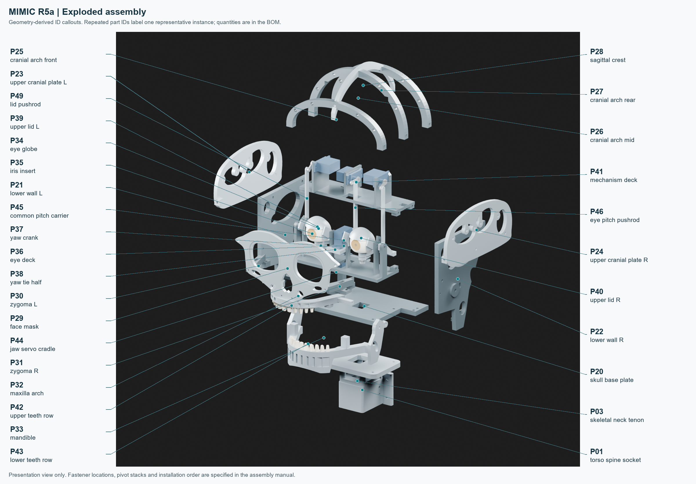
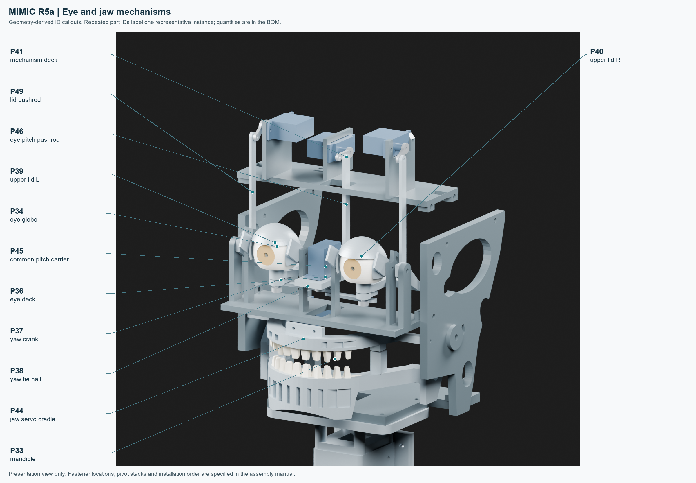

The following sequence preserves access to internal nuts and pivots. Read the full module step before installing its fasteners. The hardware schedule in section 3 provides exact set quantities, locations and nominal axes. Keep servo power disconnected during mechanical work. Do not force a printed fit or use a servo to overcome binding.

## 6.1 Inventory and fit approval

1. Match every printed component to the section 2 BOM and the plate map. P90 is a bench fit coupon, not a head component. Remove supports from internal bores and channels before inserting hardware. Mark left/right parts on concealed surfaces.
2. Measure the actual servos and OEM horns. The CAD's nominal microservo envelope is not identification of the user's hardware. Verify mounting-hole pitch, body clearance, shaft position, horn radius, horn thickness and spline screw access against the final contract. Any mismatch requires a source change and re-verification before assembly.
3. Trial the coupon holes, nut seats and insert fit with the purchased hardware. Deburr metal shafts and printed edges. Use measured finishing only; record final bore sizes and any rework. Dry-fit the neck and mounting interfaces without forcing them.

## 6.2 Base, walls and jaw-servo cradle

4. Set P20 on a supported bench with its underside accessible. Attach P21 and P22 using H_BASE_P21 and H_BASE_P22, screws from above and nuts below. Keep the base flat while snugging the structural bolts. Do not install P03 yet: it can obstruct underside access.
5. Install P44 with H_JAW_CRADLE_BASE, engaging the two underside nuts before the neck is fitted. Trial the CH1 servo body and tab bolts H_SERVO_JAW. Leave the horn disconnected until detached-servo neutral has been measured in section 8. Confirm the actual cable exit is clear of the base, ramus and neck.
6. Join P23/P24 upper plates to P21/P22 using H_PLATE_P23/H_PLATE_P24, outside heads and inside nuts. Fit P41 with H_DECK_-1/H_DECK_1 before the pitch/lid servos obstruct access to the inner nuts. Fit the structural arches P25/P26/P27 with their H_ARCH sets; defer P28 if it obstructs top access during mechanism work.

## 6.3 Common-pitch eye cassette

7. Secure fixed eye deck P36 to the sidewalls using H_EYE_DECK_-1 and H_EYE_DECK_1. Reach the inside nuts before installing the globes. Check that the deck is seated without twist.
8. Assemble P45 between the fixed supports using H_PITCH_PIVOT_-1 and H_PITCH_PIVOT_1. The screws are stationary and P45 rotates on its running bores. Install the specified washer stack and retained nuts; adjust for the contract's axial play rather than clamping the carrier. Fit H_PITCH_STOP: its M2x12 pin traverses the fixed R14 slot on the left support. Keep the pin sliding freely. Support the carrier while checking free rotation.
9. Install the nominal CH0 yaw servo in P45 with H_SERVO_YAW. This servo moves with the pitch carrier. Route its cable rearward through a flexible service loop; check the loop at both pitch limits. Leave its OEM horn unattached until measured neutral is known.
10. Fit the radial captive nuts in each P34 globe and P37 crank before inserting the 3 mm metal yaw shaft. Insert the diameter 3 x 33 mm H_YAW_SHAFT_-1/H_YAW_SHAFT_1 shafts (neutral Z84..117); retain them with H_YAW_COLLARS (3 mm ID, at most 7 mm OD, 3 mm long). The lower collar occupies Z84..87 and upper collar Z105.2..108.2. Verify the actual collar screw envelope and install the H_GLOBE_CLAMP and H_YAW_CRANK_CLAMP set screws. Use the required local shaft flats. The shaft is clamped separately to globe and crank; it rotates freely in the carrier. Aim both globes forward and align both crank holes rearward before securing the clamps. Verify retention against an axial pull by hand.
11. Install the two P38 tie halves using H_YAW_LINK_LEFT, H_YAW_LINK_RIGHT and H_YAW_LINK_CENTRE. Their planes are staggered as shown in CAD. Use the 1 mm spacer at the left M2x20 pin and 3.5 mm spacer at the right M2x16 pin. The longer left pin also traverses the carrier yaw-stop slot: head above carrier, nut below link. Keep its stop-slot motion free. The center is a single retained OEM horn pin carrying both links. Do not substitute a printed spline. Hand-check both globes stay synchronized without bind throughout the permitted yaw range.
12. Install CH2 pitch servo on P41 with H_SERVO_PITCH. Fit P46 between the common carrier and the OEM pitch horn using H_PITCH_ROD. Preserve the specified rod plane and metal spacer alignment. Connect the horn only after detached-servo calibration and with the carrier physically at its recorded neutral. Check both eye axes manually with the lids absent first.

## 6.4 Upper eyelids

13. Fit P39/P40 to P36 using H_LID_PIVOTS. There are four retained pivots; the washers occupy the specified lid/prong gaps. Set running axial play and confirm each lid rotates independently without being pinched by its pivot screw.
14. Install H_LID_STOP_-1/H_LID_STOP_1 in the fixed curved-slot arrangement. The pin must slide and the nut must remain retained. A stop is a last travel boundary, not an operating position for a powered servo.
15. Attach the CH3/CH4 servos to P41 using H_SERVO_LID_-1/H_SERVO_LID_1. Install the two P49 pushrods with H_LID_RODS and the specified lower/upper metal spacers. Use M2x14 pins with nominal 4.45 mm lower and 1 mm upper metal spacers; verify these against the actual horn thickness. Keep the rods at X = -58.5 and +58.5 mm. Fit each OEM horn at the measured start pose after section 8 calibration. Check lid travel with both eyes at every permitted gaze extreme; a clear lid at center gaze does not prove combined clearance.

## 6.5 Jaw and face

16. Trial P32's side supports using H_MAX_P21/H_MAX_P22 before the jaw blocks access. Keep the teeth absent while checking mechanical travel. Seat the specified heat-set insert in P33 only after its actual outer diameter and installation method have been confirmed using P90. Allow it to cool and inspect for cracks/distortion before applying load.
17. Support P33 and install H_JAW_LEFT_PIVOT from the outboard side. Use one H_JAW_SLEEVE at each side: diameter 4 mm OD / 3.2 mm ID tube, 12.9 +/-0.05 mm long, with square deburred ends. The screw clamps the sleeve to the jaw; the sleeve rotates in the 4.2 mm wall bore. The nominal wall/ramus stack is 12.5 mm, leaving 0.4 mm free axial clearance. Left: one 0.5 mm washer and M3x18 screw into the M3x4 insert; nominal engagement is 3.6 mm and the tip must not intrude into the horn. Right: H_JAW_RIGHT_PIVOT M3x25 screw, two 0.5 mm washers and nyloc nut. Measure the actual stacks before tightening; do not clamp either ramus against a wall.
18. Install H_JAW_STOP through the curved right-wall slot. Check sliding action and both travel boundaries by hand. Couple the measured-neutral CH1 OEM double-arm horn using H_JAW_HORN only if the actual two-hole pattern and spline position match. Retain its OEM center screw. With actuator power off, verify jaw motion is free and does not load a stop or contact the neck.
19. Attach P30/P31 zygoma roots with H_ZYG_ROOT_-1/H_ZYG_ROOT_1. Offer up P29 and retain its side pads using H_FACE_P23/H_FACE_P24, zygoma face bolts H_ZYG_P30/H_ZYG_P31 and lower nasal/maxilla interface H_MAX_FACE. Keep the face removable for service. Verify driver access before tightening the final cosmetic assembly.
20. Fit P42 and P43 teeth using H_TEETH_P42/H_TEETH_P43 at the rear carrier locations. Confirm nut engagement and tooth-to-tooth clearance throughout jaw travel. Trim projecting fasteners only when measured excess is documented and full engagement remains. Retain each P35 iris with two approximately 1 mm dots of neutral-cure flexible RTV at its rim (H_IRIS_RTV). Cure off the mechanism and keep the pupil/LED aperture clean. This is a removable cosmetic joint: cut the dots to replace the insert. Check that neither insert can dislodge into the mechanism.
21. Complete P28's three crest laps with H_CREST. Check all moving-part swept volumes again with the complete cosmetic assembly installed. A successful bare-mechanism sweep does not qualify the assembled face.

## 6.6 Neck interface and harness

22. With the jaw supported and all underside-access work complete, attach P03 to P20 using H_NECK_FLANGE. Preserve the 80 x 45 mm hole pattern and the central harness opening. Insert P03 into P01 without force and fit H_NECK_LOCK through the two cross-lock holes. Check the actual printed fit before fully retaining the head.
23. Keep the head on a stable supported fixture. The recovered torso socket does not establish the strength or fit of an absent torso or active neck. Measure final head mass/center of mass and design the next support module separately before full-body integration.
24. Label both ends of each servo cable CH0-CH4. Route cables through P41's tie slots with removable strain relief and through the neck passage only after confirming connector insertion. Keep power conductors away from I2C/audio runs where practical. Check all service loops across the full manual travel envelope; no cable may become a mechanical stop.
25. Photograph the installed fasteners, pivots and wire routes. Record manual sweep clearances, axial play and stop contact in `physical_verification.csv`. Continue to electrical tests only after the unpowered mechanism is assembled and inspected.

## Horn alignment rule for all five channels

Run detached-servo commissioning from section 8 before connecting a horn/linkage. A 1500 us command does not define a mechanical zero. With the servo at its measured neutral and the mechanism supported at its physical neutral, isolate actuator power and attach the OEM horn at the closest matching spline index. Retain the manufacturer's center screw and connect the appropriate measured pin radius. Recheck the neutral mechanically before enabling the coupled axis. If spline indexing leaves an offset, measure and record the resulting pulse neutral; do not force a linkage to an assumed zero.

The software limits are electrical pulse limits derived during commissioning. The final contract's nominal angular envelope is not a pulse-to-angle conversion. Stops, hardware, tolerances, wiring and actual output movement must be checked together before allowing all-channel motion.

## Nominal motion envelope - physically unverified

| Axis | Operating range (deg) | Geometric stop range (deg) |
| --- | --- | --- |
| Linked yaw | -20 to +20 | -22.99 to +22.99 |
| Linked pitch | -12 to +12 | -14 to +14 |
| Jaw | 0 to 14 | -0.4 to 17.03 |
| Left/right lid | 0 to 50 | -2.99 to 52.99 |

These are final CAD nominal angles, not confirmed physical limits or PWM commands. The jaw closing stop was revised to -0.4 deg to limit overclosure. Measure print error, backlash, tooth clearance and real stop contact before choosing narrower calibrated operating limits. Do not command a servo into a stop.
