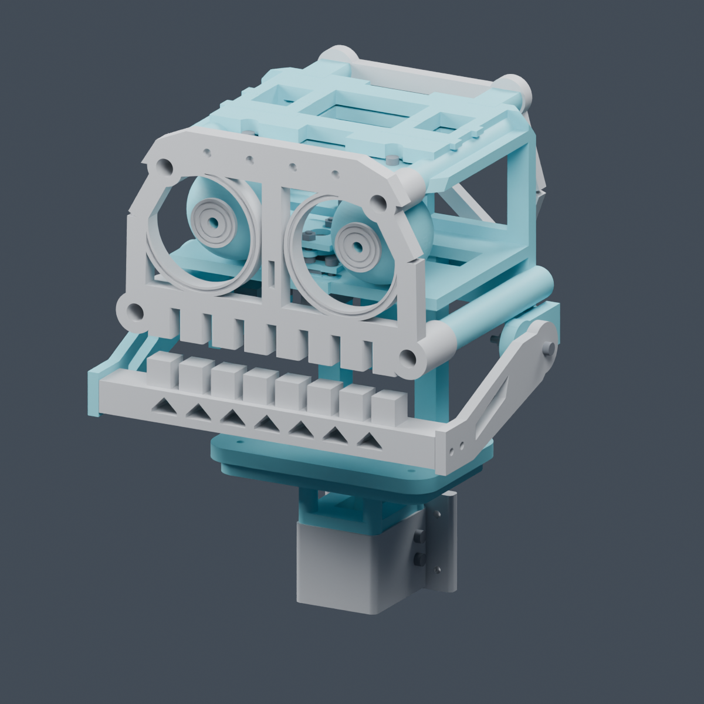

# Mimic Head M3 retrofit

This prototype adapts the Mimic R4 head to the M3 fasteners in the pictured kit. It retains the original servo horns and their center screws.

[What changed from R4](START_HERE.md#what-changed-from-r4) · [Illustrated assembly steps](START_HERE.md#assembly-order)

1. Open [plate 00](PRINT_PLATES_3MF/00_FIT_TEST_FIRST.3mf) at 100% scale and slice it for your Adventurer 5M. The numbered plates contain model geometry and need slicing.
2. Test the horn and servo tab clamps on your hardware. Follow the [assembly guide](START_HERE.md) before printing plates 01–06.
3. Use the [reprint list](REPRINT_LIST.csv) and [hardware list](hardware_BOM.csv) to prepare the build. If an original part needs replacing, its mesh is in [REUSED_R4_STL](REUSED_R4_STL).
4. Follow the [firmware guide](firmware/README.md) and [wiring diagram](wiring/ESP32_PCA9685_wiring.svg) for setup and calibration.

The design cleared 17 sampled positions in CAD using nominal servo dimensions. Physical fit and operation still need testing on the actual hardware.

[Assembly preview](preview/01_complete.png) · [Rear mechanism](preview/02_mechanism_rear.png) · [3D assembly](preview/Mimic_M3_assembly.glb)
