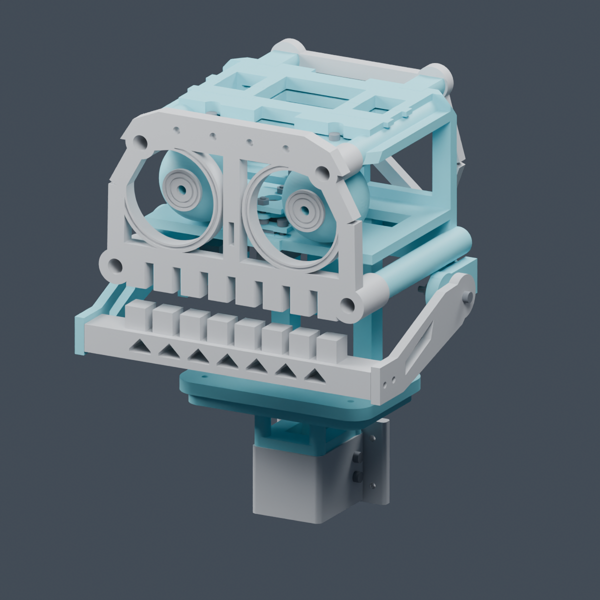
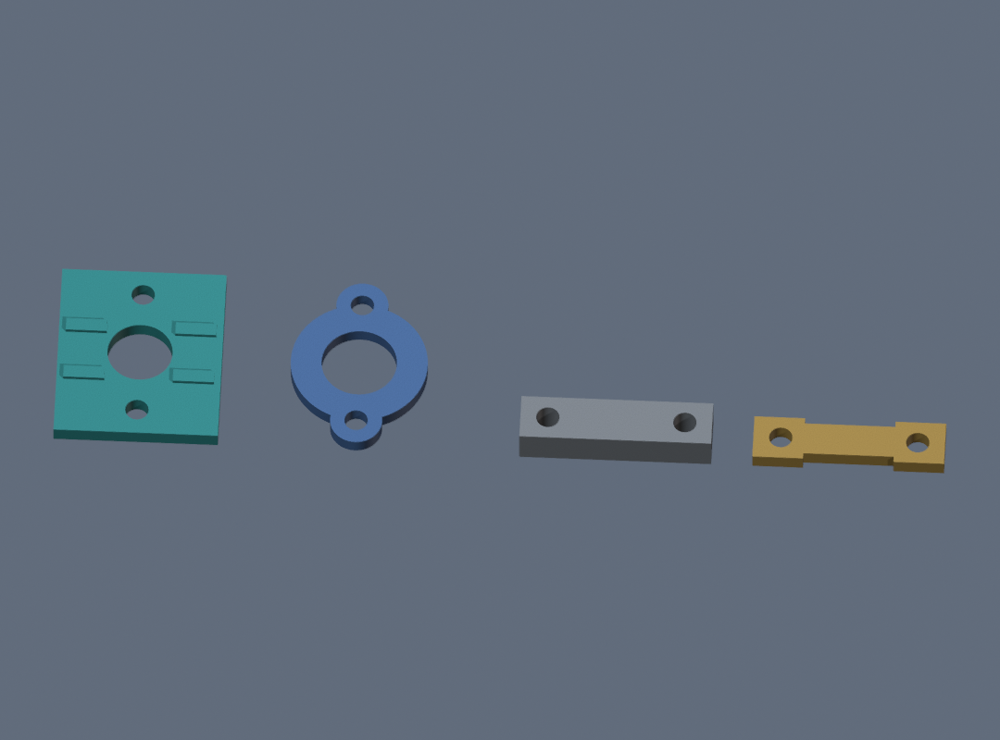
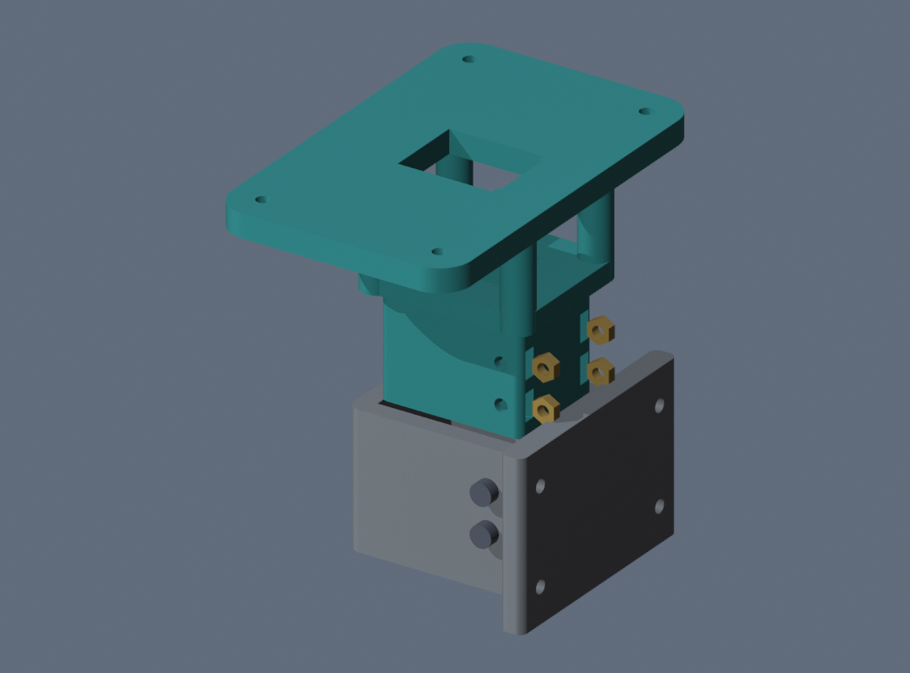
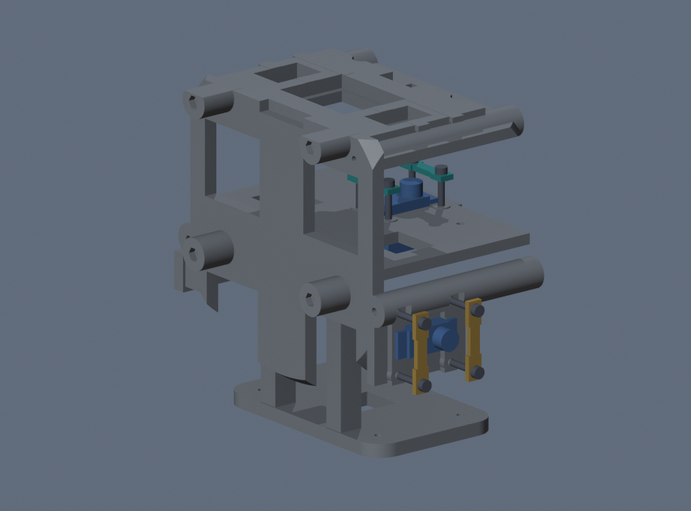
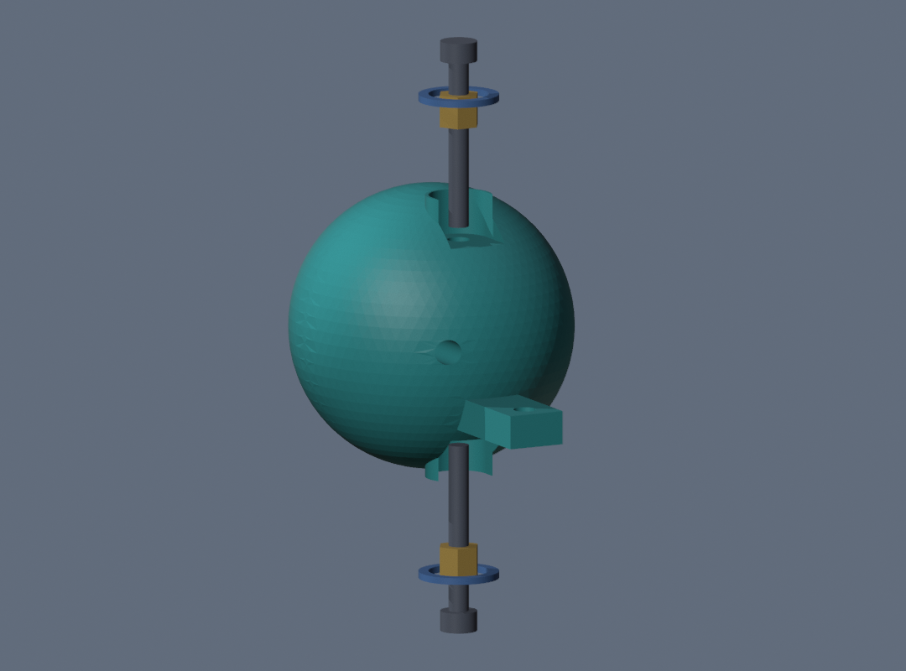
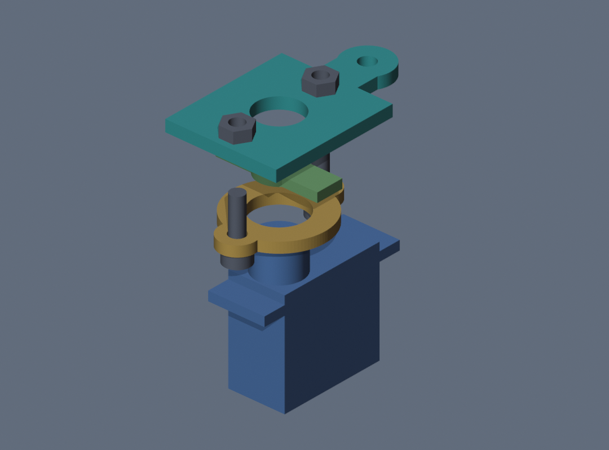
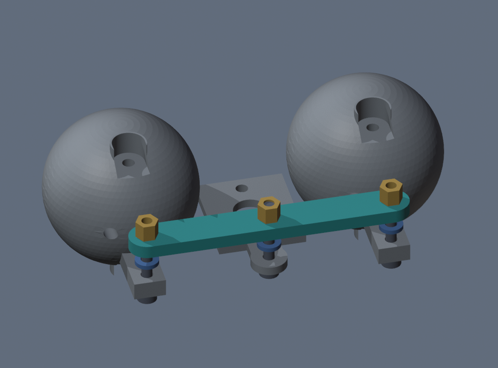
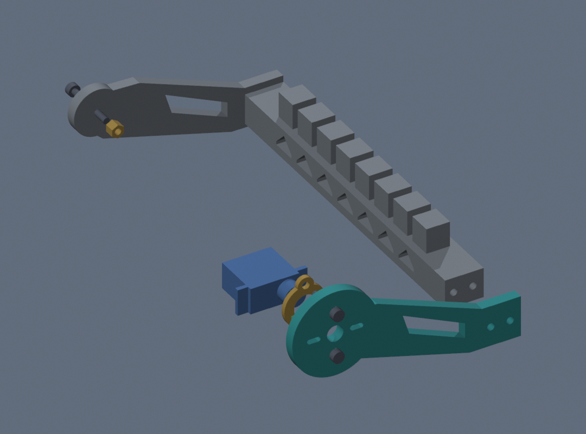
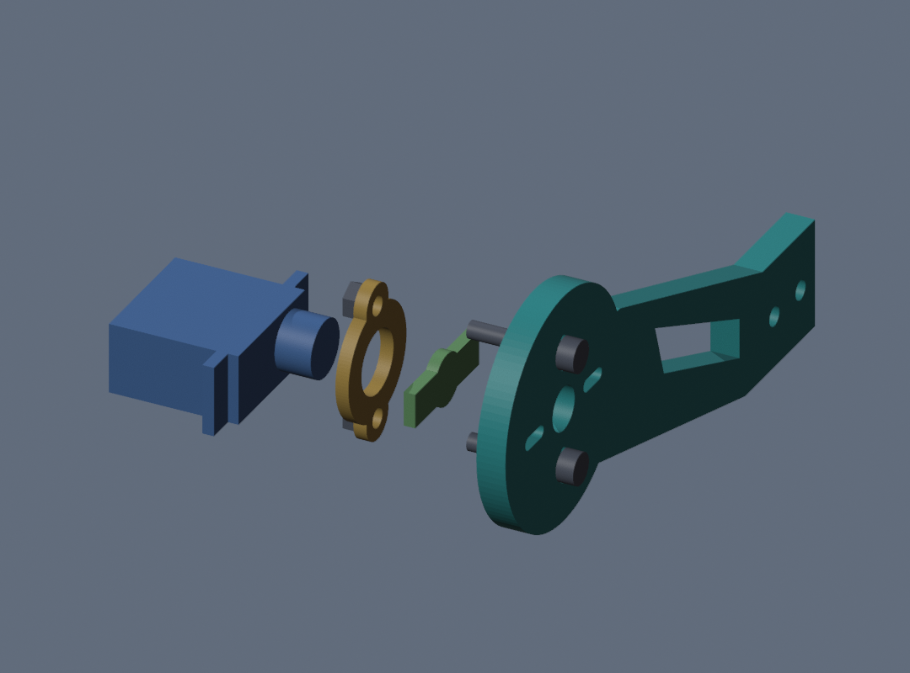
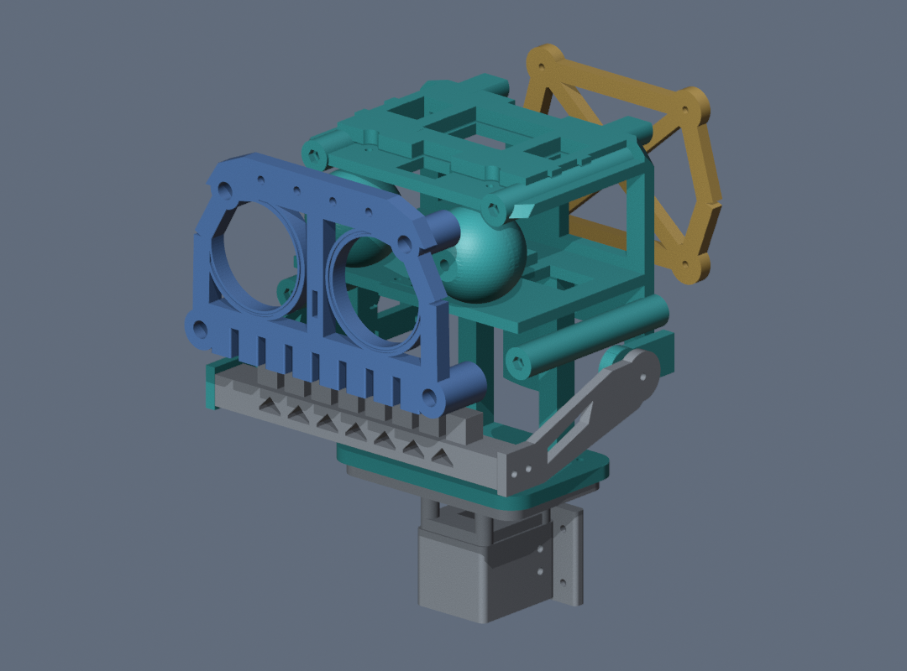

# Mimic head: M3-kit retrofit prototype

This separate revision adapts the local Mimic R4 head to the pictured HAPRIC M3 x 6–30 mm kit. It uses metal M3 machine screws and ordinary M3 hex nuts, plus the two original servo horns and their original spline-center screws. Wiring is unchanged. Do not use the old R4 hardware instructions for the revised joints.

**Print plate 00 first. Do not commit to the large reprints until the actual horn and servo-tab fit tests pass.** This is a digitally checked, physically untested prototype. The supplied servo and horn envelopes are nominal; your actual DIANN parts have not been measured. A fit-test failure means the relevant adapter needs adjustment, not force or drilling of the servo.

## What changed from R4

| Area | Revision change |
|---|---|
| Neck | P03 captures four ordinary nuts. Four short M3×12 side screws secure it in the reused P01 socket in place of the long through-bolts. |
| Internal frame | P04 has seats for the A01 eye and A03 jaw clamps. M3 screws run alongside the servo tabs and tighten the bridges down over them. |
| Eye pivots | Each P05 eye rides on two opposing M3×25 screws. New P10 rings set the bearing faces, and paired nuts hold the screws to the shelves. |
| Eye drive | P07 and A02 clamp the original straight horn. P06 and P11 form the new linkage stack around M3×20 screws. |
| Jaw drive | P08 and A02 clamp the original jaw horn. The right arm P18, spacer P09, and tooth bridge P19 can be reused. |
| Outer pieces | Reuse the P12 face, P13 rear truss, and P15 pupils. The [R4 wiring and commissioning files](firmware/README.md) cover the two-servo build. |

The pictures below are CAD views of this retrofit. The colors identify parts in each view, and gaps in the exploded views show how the pieces go together. Use the instructions for the installed clearances.

## What to reprint

| ID | Part | Copies |
|---|---|---:|
| P03 | Short-bolt neck insert | 1 |
| P04 | Internal frame with M3 servo clamp mounts | 1 |
| P05 | Eyes with short-pin recesses and M3 linkage bores | 2 |
| P06 | M3 eye connecting bar | 1 |
| P07 | Eye-horn sandwich adapter | 1 |
| P08 | Left jaw drive arm with horn clamp | 1 |
| P10 | Enlarged eye thrust rings | 4 |
| P11 | M3 linkage washers | 3 |
| A01 | Eye-servo tab clamp bridges | 2 |
| A02 | Horn clamp plates, one per servo | 2 |
| A03 | Jaw-servo tab clamp bridges | 2 |

**Reuse:** P01 neck socket, P09 right-jaw spacer, P12 front face, P13 rear truss, both P15 pupils if fitted, P18 right jaw arm and P19 tooth bridge. Keep the old parts until their replacements fit. Do not mix old P05/P06/P07/P10/P11 with the revised eye mechanism.

## Open these in Flash Studio

`PRINT_PLATES_3MF` contains numbered geometry-only plates for a 220 x 220 mm bed. Import each plate as model geometry at **100% / millimetres**. Each plate already contains its required duplicate pieces. Print each plate once, in order; do not also print the individual STLs. The STLs are an alternative, with the required copy count in each filename.

These are not sliced printer jobs. Select your Adventurer 5M, actual nozzle and filament; inspect every layer and supports before slicing. Start with your proven PLA profile, 0.20 mm layers, 4 walls and 5 top/bottom layers. Use 5–6 walls for P03/P04 and approximately 35% infill for loaded joints. Do not scale parts to fix one tight hole.

| Plate | Contents / support guidance |
|---|---|
| 00 FIT TEST FIRST | Four small test pieces; print flat in supplied orientations, no supports normally needed |
| 01 NECK | P03 flange down; review supports between neck posts and beneath shoulders; clear all four nut-loading slots |
| 02 FRAME | P04 rear down; support suspended servo shelves, ribs and posts; keep mounting holes/nut pockets accessible |
| 03 EYES | Two P05 eyes and four P10 rings; eyes need supports on curved surfaces; clear recesses and rear nut-access slots; rings print flat |
| 04 EYE LINK | P06, P07 and three P11 washers; flat faces on bed; normally no supports |
| 05 LEFT JAW | P08 broad outside face on bed; normally no supports |
| 06 CLAMPS | Two each A01/A02/A03; flat, normally no supports |

## Fit tests before larger prints

From left to right, the teal and blue coupons (T01/T02) test the horn clamp. The gray and gold coupons (T03/T04) test the servo tab clamp.

1. Use an original **straight, double-ended horn**. The adapter assumes approximately 22 mm total length, at most 6.2 mm arm width, and 2 mm thickness at the clamping faces. Retain the manufacturer's spline and center screw; never print a replacement spline.
2. Put that horn between T01 and T02. T01's small underside cheeks sit along the sides of the horn arms. Two M3x10 screws pass beside the horn through the plates, with ordinary nuts; no screws go through the horn's tiny holes. Test without mounting it to a powered servo. Both plates must grip the arms evenly without bending the horn, flexing the plates, or slipping under a gentle hand twist. The central access hole must remain clear.
3. T03/T04 test the servo-tab clamp: rest a servo mounting tab on T03 and bridge over it with T04. Use two M3x16 screws and nuts in the holes beside the tab. The relieved bridge edges must clear the servo body; it must clamp the tab evenly without loading the cable exit or crushing the plastic. A01 uses this same cross-section. A03 spans a wider screw spacing at the jaw.
4. If either test binds, the horn is loose, or the tab does not fit, stop before the frame print. The tests establish fit only, not load capacity. Save the tiny original servo-center screws.

## Exact hardware count for the revised head

| Hardware | Total needed | Pictured kit quantity |
|---|---:|---:|
| M3x10 | 2 | 25 |
| M3x12 | 4 | 25 |
| M3x16 | 22 | 25 |
| M3x20 | 7 | 25 |
| M3x25 | 5 | 15 |
| Ordinary M3 nuts | 48 | 200 |
| Metal M3 washers, 7–8 mm outside diameter | 8 | 200; check actual diameter |
| Original servo spline-center screws | 2 | Supplied with the servos, not the M3 kit |

No M2, M3x45, M3x60 or nylon-insert nuts are required by this revision. Fit-test hardware can be reused for final assembly. The future stand/torso mounting still needs four M3 bolts and nuts; choose the length for the actual plate thickness plus the 6 mm socket flange. That mounting is not included in the totals above.

Tools: metric hex keys for your socket-head screws, the correct screwdriver for the OEM servo-center screws, and a 5.5 mm nut wrench/small suitable pliers. Two tools are needed to lock the pivot nut pairs without tightening the moving joint.

## Assembly order

### 1. Neck — reuse P01, replace P03

Teal is the new P03 insert. The gold nuts load from the rear. Once the insert seats in the gray P01 socket, drive the M3×12 screws in from both sides.

Load four plain M3 nuts into P03's rear-opening slots: one at each side of each of the two cross-bolt levels. Their hexagonal pockets locate the nuts. Trial-fit before inserting the neck into P01; the socket then covers the loading openings. Attach P03 to P04 with the original four M3x20 screws and four plain nuts.

Insert P03 fully into P01. Use **four M3x12 screws**, two from each side of P01, engaging the four captured nuts. These replace the two old M3x45 through-bolts. Do not use M3x20 here: opposing tips would meet. Tighten evenly by hand. Check the shoulder is seated and the neck cannot rock. Attach P01 to a rigid support before adding the head; it is not a freestanding base.

### 2. Servo mounting clamps

The blue servo bodies sit in the gray P04 frame. Lower the teal A01 bridges onto the eye servo tabs and bring the gold A03 bridges inward over the jaw servo tabs.

Fit each servo in its original orientation. The eye servo shaft points upward in the CAD, with the original horn across left/right. The jaw servo shaft points out toward the left of the head. Preserve the original servo center locations.

Use two A01 bridges over the eye servo's mounting tabs and two A03 bridges over the jaw servo's tabs. **Two M3x16 screws and two ordinary nuts per bridge:** eight screws/nuts total. Screws straddle the original tabs, not their small holes. Eye screw heads are above the bridges, nuts below the frame. Jaw screw heads are outboard, nuts in the enlarged inboard pockets. Tighten only enough to hold the servo without crushing the tab. Confirm the body and lead exit remain clear.

### 3. Short eye pivots

The frame shelves are omitted in this close-up. The blue P10 rings sit between the eye and the shelves. Each screw carries a pair of gold nuts that you reach through the recess at that end of the eye. Repeat this stack for the other eye.

Each eye uses **two M3x25 screws**: an upper screw down through the top shelf and a lower screw up through the bottom shelf. Their tips point toward one another with a nominal 5 mm gap. Each screw is locked to its frame shelf with **two ordinary M3 nuts**, inside the enlarged end recess of the eye. That is four nuts per eye, eight total.

Place one new P10 ring above and one below each eye. Hold the eye between the shelves, feed the screws inward through the frame and the rings, and thread the two nuts onto each screw through the rear access opening before advancing the tip into the eye's central bore. Seat the first nut against the frame shelf; hold it and tighten the second against it. The nuts secure the stationary pin to the frame, **not to the eye**. The eye rotates around the short pins. Keep the large recess clear of nut corners and remove printing debris. Do not fit a nut in the middle of the eye.

The eyes should rotate freely without forcing them. The nominal axial float is 0.5 mm total. Lightly smooth a thrust face if needed; do not tighten the pins to crush away the running clearance. These kit screws have threaded bearing surfaces: check friction and wear during use. The new P10 rings have larger holes than the old washers and are essential here.

### 4. Horn clamps and linked eyes

From the servo up, the stack is the blue servo, gold A02 plate, green stock horn, and teal P07 adapter. The two M3×10 screws pass upward beside the horn.

Center each bare servo using the existing commissioning firmware, then disconnect servo power before attaching its horn. Keep the jaw supported while unpowered.

For the eye servo, put A02 around the servo boss **before** fitting the stock straight horn and its original center screw. The stock horn runs left/right; P07 rests above it with its crank pointing rearward. Sandwich the horn between A02 and P07. Use **two M3x10 screws upward from underneath A02**, with two ordinary nuts on top of P07. Screw heads must be underneath the clamp plate, not beneath the nuts. Confirm a gap remains over the fixed servo-mount bridges throughout eye travel. The CAD assumes the stock horn upper face is at Z102.5; a different actual horn seating height can misalign the linkage and must be corrected before running.

Use P06 with three new P11 washers below it. Fit **three M3x20 screws upward from beneath the cranks**, plus two ordinary nuts per screw above P06. Set both eyes straight ahead. Leave about 0.3 mm clearance above the link with the first nut; hold that nut still while jamming the second against it. The two nuts lock together, while the link remains free. Do not simply leave one ordinary nut loose. Check that each pair stays locked as the eyes move.

Lower the teal P06 bar onto the three blue P11 washers. The three gold nut pairs go on top.

### 5. Jaw

Attach the teal P08 arm and the gray P18 arm to the ends of the P19 tooth bridge. The blue P09 spacer belongs at the right-side pivot.

Reuse P18 and P19. Attach the new P08 left arm and original P18 right arm to P19 using four M3x16 screws and four ordinary captured nuts, as in R4.

Place the gold A02 plate on the servo side, then fit the green straight horn with its original center screw while the jaw servo is centered and unpowered. Set teal P08 on the outside with the horn arms between its locating cheeks. Use **two M3x16 screws from outside P08**. They pass beside the horn into A02, with two plain nuts on the servo side of A02. Check that the nuts and bolt tips clear the frame as the jaw opens.

Reuse P09 on the right pivot. Use the original **M3x25** screw and **two ordinary M3 nuts** on the inside of the frame. Set slight running clearance with the first nut, hold it still, and jam the second against it. Do not clamp the moving arm rigidly. Check there is enough thread beyond both nuts and that the joint turns freely.

### 6. Face, rear truss and commissioning

After checking motion with the covers off, fit the blue P12 face from the front and the gold P13 truss from the rear.

Reuse P12/P13 and their eight M3x16 screws, eight ordinary nuts and eight metal washers. Fit these only after proving the bare mechanism. Reuse P15 pupils if desired.

Wiring and GPIO pins are unchanged. Use the existing R4 firmware and recheck its calibration for the new physical assembly. The CAD checks eye yaw to +/-18 degrees and jaw opening to 20 degrees; actual safe travel may be smaller. Commission one axis at a time using small pulse changes. Stop if the joint rubs, the horn slips, or a servo buzzes. Recheck all paired pivot nuts after initial hand cycling and the first powered test.

## Verification and limits

See `checks/mesh_validation.json`, `checks/assembly_clearance.json`, and `checks/plate_validation.json`. Closed meshes and nominal collision checks do not establish printed strength, grip on your actual horn, servo behavior, wire clearance, friction, or long-term fastener retention. Hardware references use nominal M3 dimensions and nominal servo/horn envelopes. The reused fixed cosmetic fasteners are omitted from the new collision model. No physical tests have been performed.

`preview/01_complete.png` and `preview/02_mechanism_rear.png` show the CAD assembly: teal is revised/new printed hardware; gray is reused; dark is reference hardware. `preview/Mimic_M3_assembly.glb` is a view-only assembly, not a print file. The source scripts rebuild in millimetres and use the original STEP inputs included under `reference_R4`.
