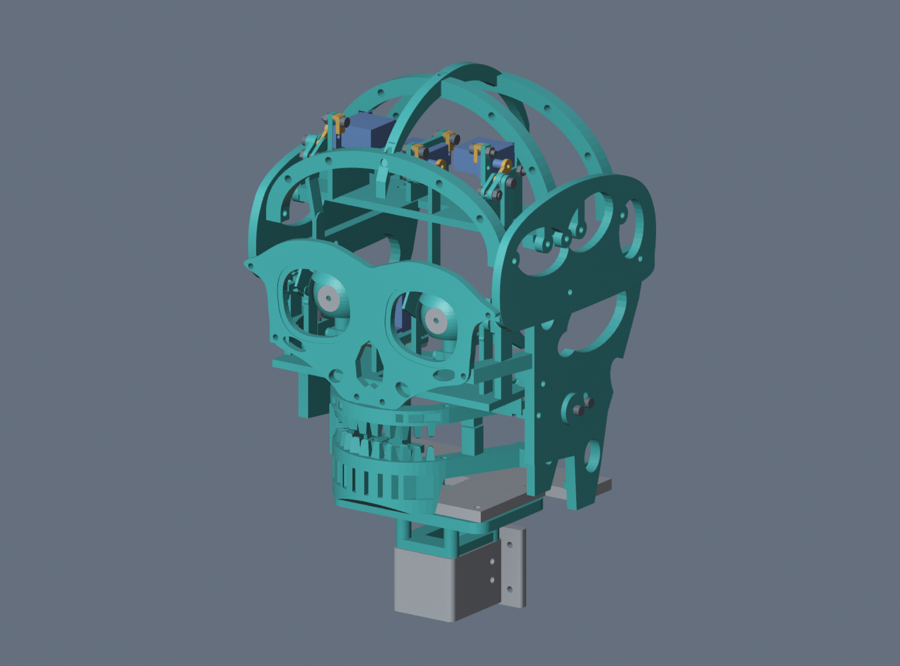
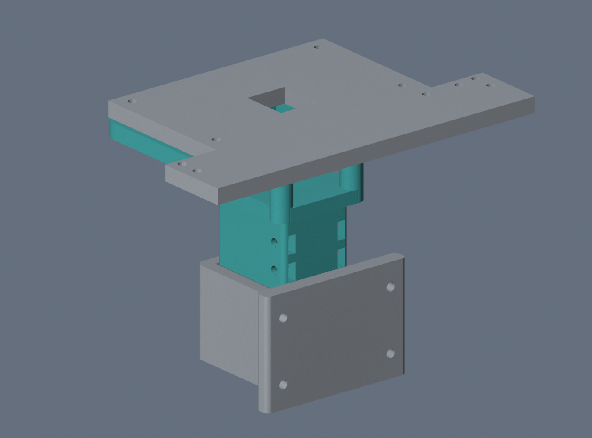
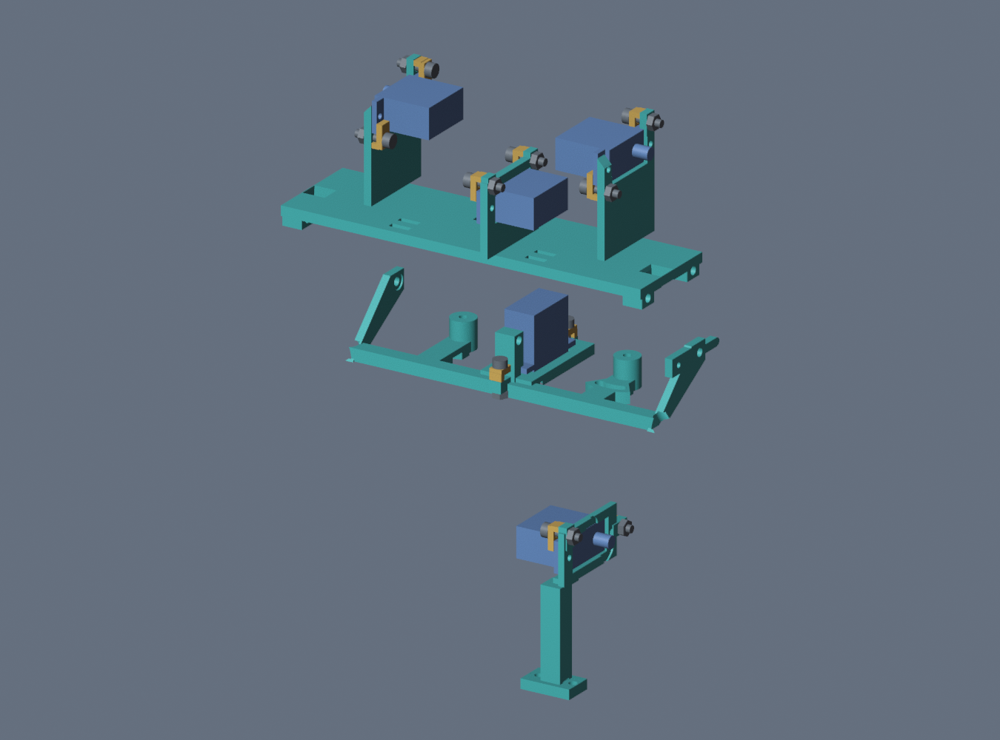
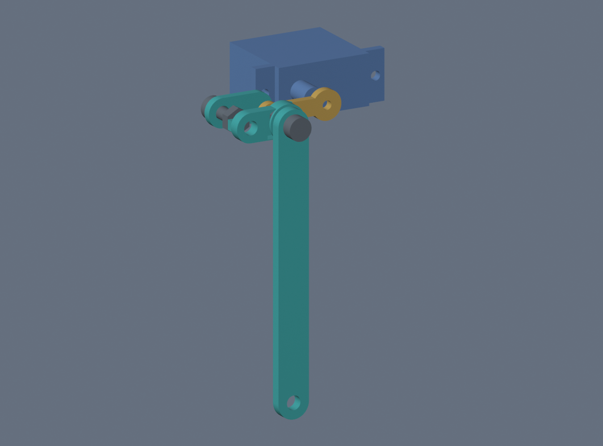
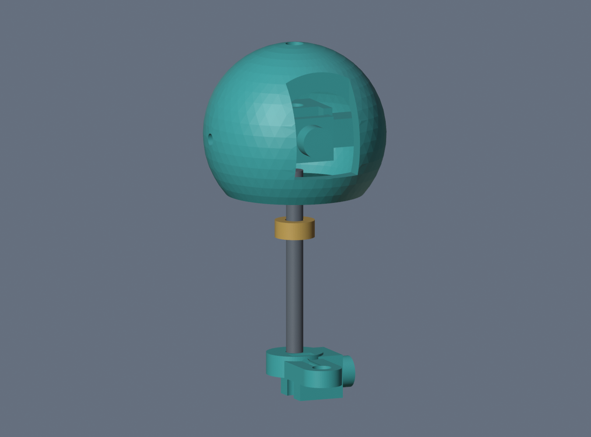
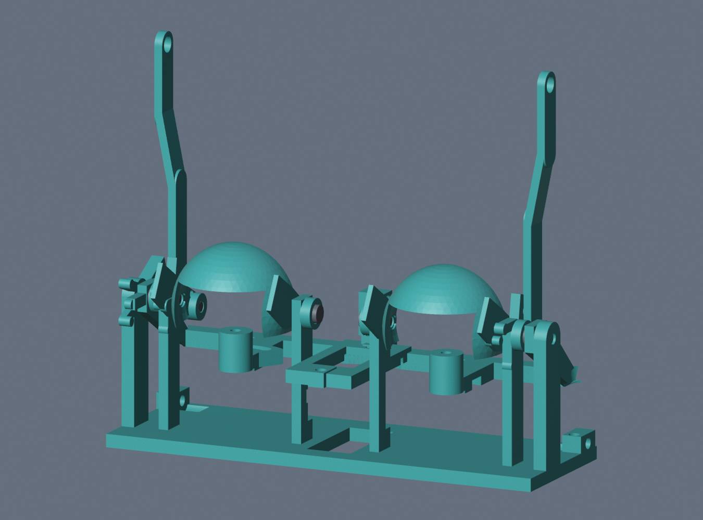
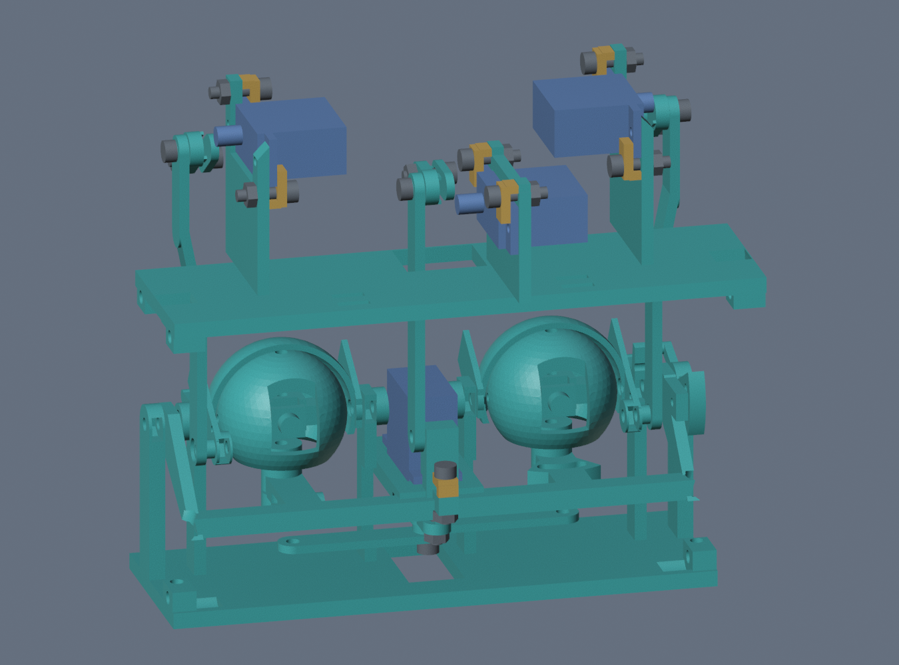
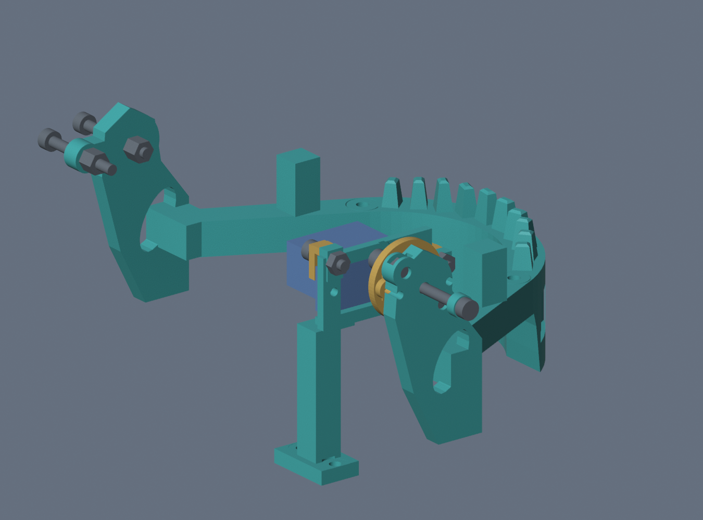

# Assemble the V5 M3 Mimic head

Use the [V5 M3 print and reprint list](README.md) and the [joint-by-joint hardware schedule](print_release/bom/hardware_schedule.csv). This guide uses the R5a five-axis channel order. The face points forward and the mechanism deck is at the rear. Left and right follow the part IDs.

## 1. Test the servo hardware first

1. Print the fit plate. Remove support and brim material from the nut pockets, holes and flat seating surfaces.
2. Use A90 and A10 to check a side clamp. Use A91 and A11 to check an end clamp. The bridge nose rests on the servo tab, and the other end bears on the fixture. Use an M3×12 and a plain nut. Check that the tab stays flat when the bridge grips it.
3. The horn is the plastic arm on the servo output shaft. Sandwich the stock single-arm horn between A40/A41 for yaw, A42/A43 for pitch or A44/A45 for each lid. Keep the stock screw in the middle of the spline. The M3×10 goes through the printed plates beyond the end of the horn, with an M3 nut on the opposite side.
4. Load the pivot nut in its slot and check that the pivot screw threads into it. Verify the horn sits flush, the adapter stays put under light hand pressure, and the linkage runs freely at the shoulder. Keep the fit plate’s usable A10, A11 and horn plates. The production plates supply the rest.

## 2. Build the neck and lower frame

1. Put P21 and P22 on the reused P20 base. Use four M3×16 with a washer at each end. Hold the nuts below the base while the underside is open.
2. Fit P03 under the base using four M3×20 and two washers per screw. Slide four plain M3 nuts into its side pockets. Seat the assembly in the reused P01 socket and use four M3×12 through the existing socket openings into the captive nuts. Dry-fit the tenon, nut pockets and socket first.
3. Install P44 to the base with two M3×16 and two washers per screw. Leave P32 and the face off until the eye deck and cheek roots are in place.

## 3. Install the servo bridges and horn adapters

| Channel | Mount | Bridges at the front and rear servo tabs |
| --- | --- | --- |
| CH0 yaw | P45 | A11 front, A12 rear |
| CH1 jaw | P44 | A11 front, A10 rear |
| CH2 pitch | P41 | A10 front and rear |
| CH3 left lid | P41 | A10 front and rear |
| CH4 right lid | P41 | A10 front and rear |

Use one M3×12 and plain nut per bridge. A12 is the longer bridge at the rear of the yaw servo. Preload the rear nut in its pocket. Seat the tab against the mounting face and tighten the bridge just enough to prevent rocking. Retain the original servo center screws and keep the linkages detached while establishing servo neutral.

Install the two single-arm lid adapters as mirror assemblies. Use M3×8 at the yaw horn shoulder and M3×6 at the pitch and lid horn shoulders. Each screw anchors in a plain nut while the linkage turns on the printed shoulder.

## 4. Assemble the eye cassette

1. Fit P45 into the fixed P36 deck. Seat one plain nut in each outer pitch support and install the two M3×6 stationary pivot screws. The carrier should swing freely on the ends of the screws.
2. Use an original smooth Ø3 × 33 mm shaft for each P34 globe and P37 crank. Place an A20 shim at each globe as shown. Load the four captive nuts in the globes and cranks and use four M3×6 radially to grip the shafts. Position each globe and crank for free motion with slight axial play, then fit the original P35 irises.
3. Use the left A21 spacer with the M3×20 tie bolt and the right A22 spacer with the M3×16 tie bolt. Each P38 tie runs between its crank and the shared yaw horn shoulder. On each crank screw, use the second nut to jam against the first while keeping the tie free to turn.
4. Put A23 between P45 and the lower end of P46. Use M3×20 and two jammed M3 nuts with running clearance. The upper end of P46 slips over the pitch horn shoulder.

5. Load the hinge nuts in P36. Fit P39 and P40 and install four M3×6 with their heads seated in the hinge reliefs. Each eyelid should swing freely. The printed tabs provide the lid and pitch stops.
6. Fit one P49 dogleg rod per side. The broad upper eye sits on the servo horn shoulder. Use one M3×8 and one captive M3 nut for the lower shoulder at each lid lever. Rotate the second P49 around its length so both lower screw recesses face out. Match the rod orientation in the rear view.
7. Attach P36 to the lower walls with two M3×20 and two washers per screw. Fit P30/P31 to the eye deck shoe while the underside is open. Drop an M3×25 and its head washer into each recessed cheek-root seat. Use a washer and nut below. Check all five servo cables for slack through movement and feed them toward the back.

## 5. Assemble the jaw

1. Put the original metal sleeves in the jaw pivots. Use a plain nut in the left P33 pocket and A24 between the head and its washer. Install the left M3×20 and right M3×25. Use two washers on the right and jam its two nuts together while leaving the jaw free to turn.
2. Center the jaw servo with the link disconnected. Use A30 and two M3×8 with plain nuts to couple the original double-arm horn to P33. Retain the original horn center screw.
3. Use an M3×25 and two jam nuts for the jaw stop. Check the stop position and free movement by hand before coupling the horn. Mount P42 to P32 with two M3×12 and P43 to P33 with two M3×16, using washers at both ends.

## 6. Close the skull

1. Install P23/P24 with four M3×16. Install P25/P26/P27 with six M3×20. Use a washer at each end. Leave off the crest while accessing the rear mechanism.
2. Preload the P41 side nuts from below. Seat the mechanism deck and secure it with four M3×20 and one washer at each outer head.
3. Load the P32 side nuts from underneath and fit P32 to the walls. Use one M3×20 and one outer washer per side. Sweep the jaw by hand again with both tooth rows fitted.
4. Slide the face nuts into the P23/P24 and P30/P31 pockets before offering up P29. Use four M3×20 for the side and cheek pads and two M3×16 for the nasal pad on P32. Fit P28 with three M3×16, with washers on both sides. Leave the cosmetic parts removable.

## 7. Verify travel and calibrate

With power off, detach the servo ends and move each joint by hand. Each shoulder and sleeve should allow movement without visible rocking. Check that the fasteners stay seated, the teeth clear and the wires remain slack. Confirm fit, nut engagement and limit positions on the actual printed assembly.

Use the [R5a pin map and detached-servo commissioning procedure](../../firmware/README.md). The nominal CAD check sampled yaw to ±20°, pitch to ±12°, jaw to 14° open and each lid from 0° to 50°. Measure usable travel on your assembly and start with smaller limits. Keep powered travel inside the physical stops.
