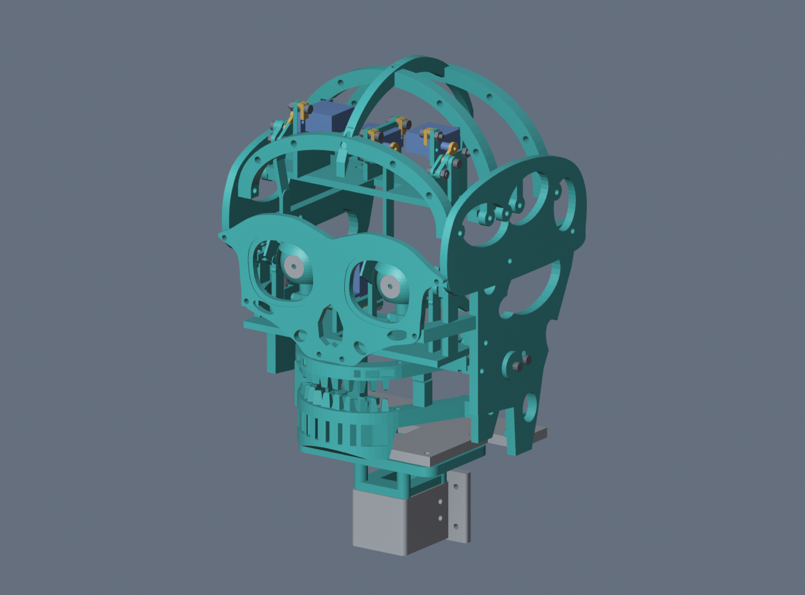

# Mimic V5 M3 retrofit

This is the M3 retrofit for the **five-axis Mimic R5a-E1**. The replacement parts use the HAPRIC M3 socket screws, plain nuts and flat washers. Keep the original servo horns and their center screws, both smooth Ø3 × 33 mm eye shafts, and both jaw sleeves (Ø4 mm outer diameter, Ø3.2 mm bore, 12.9 mm long).

## Print in this order

1. Open the [sliced fit plate](print_release/fit_first/FIT_FIRST_AD5M_PLA_0p4_sliced.3mf) in OrcaSlicer or Orca-Flashforge. Use **Flashforge Adventurer 5M, 0.4 mm nozzle, PLA and 0.20 mm layers**. Check the preview and confirm the printer and filament profile before sending. [Fit plate layers](print_release/fit_first/FIT_FIRST_layers.png)
2. Follow the [illustrated assembly guide](ASSEMBLY.md#1-test-the-servo-hardware-first) to check the OEM servo arms, bridge clips and M3 nut pockets. Keep the eight usable fit-plate pieces A10, A11 and A40 through A45. A90 and A91 are the two test fixtures.
3. After the fit check, print each production plate once. These projects contain slicer-generated toolpaths. Review each plate in Preview, and reslice if you change a profile, filament setting or part placement.

| Sliced 3MF | Group | Exact parts on the plate | Layers |
| --- | --- | --- | --- |
| [PL01](print_release/3mf/plates/PL01_AD5M_PLA_0p4_sliced.3mf) | Frame | P23, P24 | [Preview](print_release/renders/layers/PL01_layers.png) |
| [PL02](print_release/3mf/plates/PL02_AD5M_PLA_0p4_sliced.3mf) | Frame | P28, P21 | [Preview](print_release/renders/layers/PL02_layers.png) |
| [PL03](print_release/3mf/plates/PL03_AD5M_PLA_0p4_sliced.3mf) | Frame | P22, P29 | [Preview](print_release/renders/layers/PL03_layers.png) |
| [PL04](print_release/3mf/plates/PL04_AD5M_PLA_0p4_sliced.3mf) | Frame | P26, P27 | [Preview](print_release/renders/layers/PL04_layers.png) |
| [PL05](print_release/3mf/plates/PL05_AD5M_PLA_0p4_sliced.3mf) | Frame | P03, P32, P30, P31, P25 | [Preview](print_release/renders/layers/PL05_layers.png) |
| [PL06](print_release/3mf/plates/PL06_AD5M_PLA_0p4_sliced.3mf) | Eyes and lids | P45, P36, P39, P40, P34 ×2, P37 ×2, P49 ×2, P46, P38 ×2 | [Preview](print_release/renders/layers/PL06_layers.png) |
| [PL07](print_release/3mf/plates/PL07_AD5M_PLA_0p4_sliced.3mf) | Jaw | P33, P44, P42, P43, A30, A24 | [Preview](print_release/renders/layers/PL07_layers.png) |
| [PL08](print_release/3mf/plates/PL08_AD5M_PLA_0p4_sliced.3mf) | Deck and bridges | P41, A44, A45, A20 ×2, A21, A22, A23, A12, A10 ×6, A11 | [Preview](print_release/renders/layers/PL08_layers.png) |

## What to reprint

- **Replace** P03, P21–P34, P36–P46 and P49. Print two each of P34, P37, P38 and P49, and one of each other P-series replacement. That is 31 replacement prints for the original V5 parts.
- **Add** A10 ×7, A11 ×2, A12 ×1, A20 ×2, A21–A24 ×1 each, A30 ×1, A40–A43 ×1 each, and A44–A45 ×2 each. Eight of these 25 pieces come from the fit plate.
- **Reuse** P01 torso socket, P20 skull base and both P35 iris inserts. The original P90 coupon is optional and has no role in final assembly. If you already printed the P03 M3 neck trial, dry-fit it and reuse it if it seats. Remove P03 from PL05 and reslice that plate to skip a duplicate.

The full set is **56 assembled print pieces** including the eight from the fit plate, plus two test fixtures. The [reprint CSV](print_release/bom/reprints.csv) gives quantities per design and links them to STL names. The [production print map](print_release/bom/PRINT_MAP.csv) lists each part by plate. Both STL and STEP backups are included. [STLs](print_release/STL_REPRINT) · [STEP](print_release/STEP)

## Hardware from your M3 kit

| Screw | Qty |
| --- | ---: |
| M3×6 | 13 |
| M3×8 | 5 |
| M3×10 | 4 |
| M3×12 | 16 |
| M3×16 | 18 |
| M3×20 | 25 |
| M3×25 | 4 |
| M3×30 | 0 |
| Plain M3 nuts | 90 |
| M3 flat washers | 79 |

Set aside all **25 M3×20** screws for the build. Use the [joint-by-joint hardware schedule](print_release/bom/hardware_schedule.csv) to sort screws before assembly. Screw counts exclude the original servo spline screws, which stay with their horns. The fit plate uses hardware you can reuse in the build.

## What changed

| Area | V5 M3 design |
| --- | --- |
| Neck and frame | P03 gets four captive nuts. Cheek, face, arch, deck and maxilla seats take kit screws and nuts. |
| Eyes and lids | Radial M3 clamps grip the original smooth shafts. The pitch and lid stops are printed into the cassette. The M3 pivots and revised rods fit around the servo mounts. |
| Jaw | The original sleeves are retained. The left pivot uses a captive nut and A24 shim. A30 couples the stock jaw horn, and the tooth rows use larger mounting lugs. |
| Servo mounts | A10–A12 bridge over the stock tabs. Four sandwich adapters attach around the single-arm horns and use the original spline center screws. |

## Checks

The revised hardware and linkages cleared 20 sampled CAD poses, the stop checks found the intended contact beyond the commanded range, and the fixed hardware envelopes cleared the nominal seats. OrcaSlicer validated the fit plate and eight production slices with embedded G-code and in-bed extrusion. Assembly and print fit still need a physical check on your parts. Start with the fit plate and hand-sweep the assembled mechanism before applying power.

[Assembly pictures and steps](ASSEMBLY.md) · [Motion report](print_release/validation/linkage_clearance.json) · [Stop contact](print_release/validation/stop_contact.json) · [Fixed hardware report](print_release/validation/fixed_hardware.json) · [Production slicing report](print_release/validation/printing_report.json)
